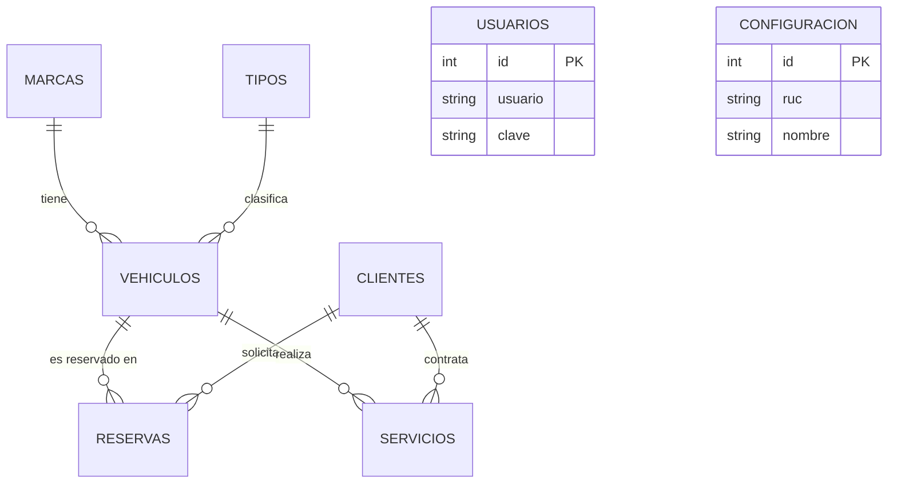
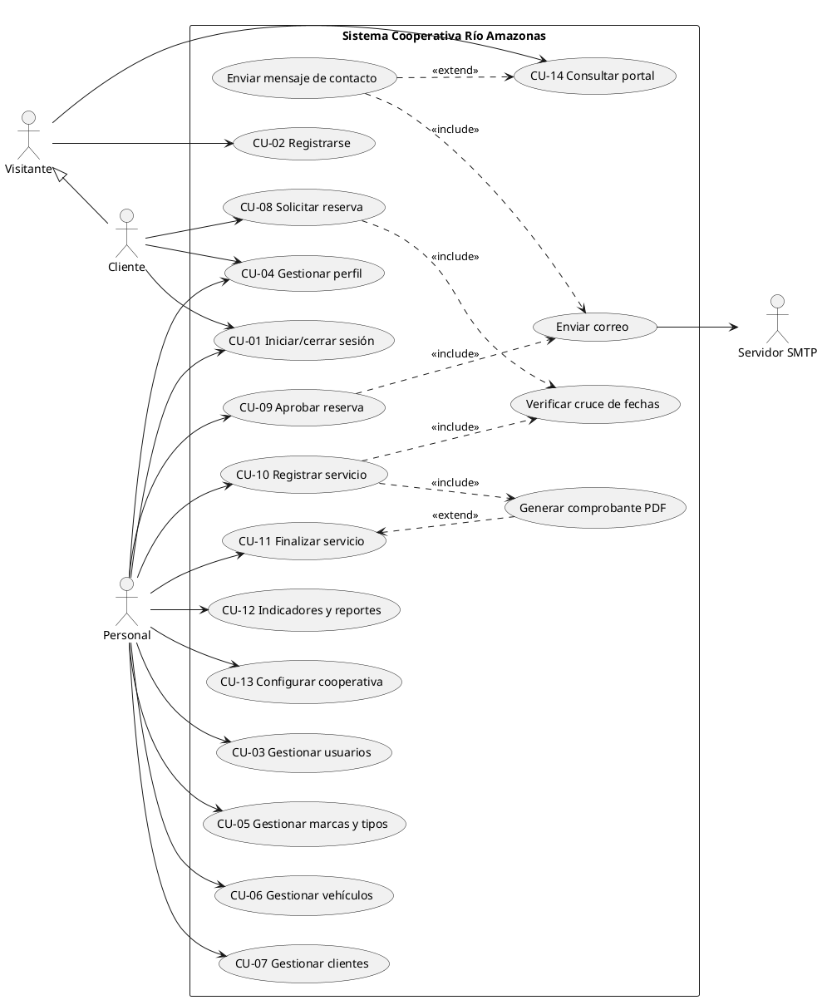

# Estado actual del sistema: Cooperativa Río Amazonas

**Fecha de corte:** 2026-11-27 · **Rama:** `main` (commit `1cbe7d7`)
**Propósito:** describir el sistema **tal como está hoy en el código**, para actualizar el documento de tesis y estructurar requisitos, casos de uso e historias de usuario.

Documentos relacionados:
- [`flujo-ejecucion.md`](flujo-ejecucion.md): recorrido `index.php` → controlador → modelo → vista, con números de línea.
- [`cambios-documento-word.md`](cambios-documento-word.md): reemplazos de términos y cambios por capítulo del Word.
- [`correcciones.md`](correcciones.md): plan del tutor.

---

> **Actualización (mejoras posteriores al corte):**
> - **Rechazo de reservas con motivo** (estado 2, columna `reservas.motivo_rechazo`, correo al cliente).
> - **Módulo de Dueños** (tabla `propietarios`, `vehiculos.id_propietario` obligatorio al guardar un vehículo).
> - **Punto de trabajo** obligatorio en la reserva (`reservas.direccion_trabajo`).
> - **Al aprobar una reserva:** correo con evento de calendario (.ics) al cliente y al dueño, y botón de WhatsApp (wa.me) al dueño.
> - **Zona horaria `America/Guayaquil`.**
>
> Migraciones en `sql/01_rechazo_reservas.sql` y `sql/02_propietarios_y_punto_trabajo.sql`. Las secciones 4 a 7 aún no incluyen estas mejoras.

## 1. Resumen

Sistema web para la gestión de **reservas (turnos) y servicios de transporte pesado** de la cooperativa. El personal administra la flota (vehículos, marcas y tipos), los clientes y los servicios. Los clientes se registran desde la página pública, consultan la disponibilidad de cada vehículo en un calendario y solicitan reservas, que el personal aprueba.

| Aspecto | Valor |
|---|---|
| Lenguaje / BD | PHP 8 + MariaDB (PDO, consultas preparadas) |
| Arquitectura | MVC propio sin framework, monolítico en un solo servidor Apache (XAMPP) |
| Frontend | HTML + Bootstrap, jQuery, jQuery UI (autocompletar), DataTables, FullCalendar, Chart.js, Alertify / SweetAlert |
| Librerías servidor | PHPMailer (correo SMTP), FPDF (PDF) |
| Controladores / Modelos | 17 / 14 |
| Tablas | 8 (`usuarios`, `clientes`, `vehiculos`, `marcas`, `tipos`, `reservas`, `servicios`, `configuracion`) |

---

## 2. Actores

| Actor | Cómo se identifica | Qué puede hacer |
|---|---|---|
| **Visitante** | Sin sesión | Ver el sitio público (inicio, beneficios, maquinaria, precios, contacto), registrarse como cliente, enviar un mensaje de contacto. |
| **Cliente** | Tabla `clientes`, `$_SESSION['tipo'] = 2`; entra con su **correo** | Consultar la disponibilidad de los vehículos, solicitar reservas, gestionar su perfil y contraseña. |
| **Personal (administrador)** | Tabla `usuarios`, `$_SESSION['tipo'] = 1`; entra con **usuario o correo** | Todo lo anterior y además: aprobar reservas, registrar y finalizar servicios, gestionar vehículos, marcas, tipos, clientes, usuarios y configuración, ver indicadores y reportes. |
| **Servidor de correo (SMTP)** | Actor secundario | Recibe los correos de aprobación de reserva y de contacto. |

El inicio de sesión **detecta el perfil automáticamente**: primero busca en `usuarios`, luego en `clientes`. El usuario no elige su rol.

---

## 3. Arquitectura (resumen)

```
Navegador ──► .htaccess ──► index.php ──► Controllers/X.php ──► Models/XModel.php ──► Query (PDO) ──► MariaDB
                                               │
                                               └──► Views::getView() ──► Views/x/*.php ──► Templates (header/footer)
```

| Capa | Responsabilidad |
|---|---|
| `index.php` | Punto de entrada único. Separa la URL en controlador / método / parámetros. Solo ejecuta métodos públicos. |
| Controlador | Valida sesión y rol, recibe datos (`$_POST`, URL), llama al modelo y responde con una vista o JSON. **No contiene reglas de negocio ni SQL.** |
| Modelo | Bloque **"REGLAS DE NEGOCIO"** (validaciones, duplicados, tarifas, cruce de fechas, fotos, correos) y bloque **"ACCESO A DATOS"** (SQL con `?`). |
| Vista | Muestra `$data`. No consulta la base de datos. Cada vista incluye su header/footer. |
| `Config/App/` | Clases base: `Controller`, `Views`, `Query`, `Conexion`, `Correo`, `Autoload`. |

Plantillas:
- **Personal:** `Templates/header.php` + `footer.php`.
- **Cliente:** `Templates/header-cliente.php` + `footer-cliente.php`.
- **Sitio público:** `Templates/header1.php` + `portada.php` + `footer1.php`.

---

## 4. Modelo de datos actual

### 4.1 Tablas

| Tabla | Campos | Estados |
|---|---|---|
| `usuarios` | id, usuario, nombre, apellido, correo, telefono, direccion, perfil (foto), clave (SHA-256), fecha, estado | 1 activo · 0 baja |
| `clientes` | id, dni, nombre, correo, codphone, telefono, direccion, clave (SHA-256, opcional), fecha, estado | 1 activo · 0 baja |
| `vehiculos` | id, placa, precio_hora, precio_dia, precio_mes, modelo, kilometraje, transmision, asientos, **peso_carga_max**, combustible, foto, estado, fecha, id_tipo, id_marca | 1 activo · 2 en servicio (*) · 0 baja |
| `marcas` | id, marca, estado, fecha | 1 activa · 0 baja |
| `tipos` | id, tipo, estado, fecha | 1 activo · 0 baja |
| `reservas` | id, **f_inicio**, **f_fin**, cantidad, tipo_precio, monto, f_reserva, observacion, estado, id_vehiculo, id_cliente | 0 pendiente · 1 aprobada |
| `servicios` | id, cantidad, tipo_precio, monto, abono, fecha_inicio, fecha_fin, observacion, estado, id_cliente, id_vehiculo | 1 en curso · 0 finalizado |
| `configuracion` | id, ruc, nombre, telefono, correo, direccion, mensaje (pie del comprobante), logo | registro único |

`tipo_precio`: **1** = por hora · **2** = por día · **3** = por mes. `monto` guarda el **precio unitario** vigente al registrar.
(*) El estado 2 solo se muestra en la tabla de vehículos ("En servicio"); hoy ningún proceso lo asigna (ver §9).

### 4.2 Relaciones



Todas las claves foráneas son `ON DELETE CASCADE ON UPDATE CASCADE`. En la aplicación **nunca se borra**: se da de baja con `estado = 0` (borrado lógico). `usuarios` y `configuracion` no tienen relaciones.

---

## 5. Módulos y funcionalidades (inventario para trazabilidad)

Cada módulo indica: pantalla/URL, actor, archivos MVC, métodos y tablas.
Las URL son relativas a `http://localhost/coop_rio_amazonas/`.

### M1. Autenticación
| | |
|---|---|
| Actor | Personal, Cliente |
| Pantalla | `login` → `Views/login.php` · JS `Assets/js/login.js` |
| Controlador | `Login`: `index()`, `validar()` · `Usuarios::salir()` (cerrar sesión) |
| Modelo | `LoginModel::autenticar()`: valida campos, cifra la clave, busca primero en personal y luego en clientes, solo cuentas activas |
| Tablas | `usuarios`, `clientes` (lectura) |
| Notas | Regenera el id de sesión al entrar. Si ya hay sesión, `login` envía a `dashboard` (el cliente termina en `reservas`). |

### M2. Registro público de clientes
| | |
|---|---|
| Actor | Visitante |
| Pantalla | Inicio (`/`) → `Views/index.php`, formulario de registro · JS `Assets/major/js/pages/index.js` |
| Controlador | `Major`: `index()`, `verify()` |
| Modelo | `MajorModel::registrarCliente()` |
| Tablas | `clientes` (INSERT) |
| Reglas | RN-01, RN-02, RN-03 |

### M3. Gestión de usuarios del personal
| | |
|---|---|
| Actor | Personal |
| Pantalla | `usuarios` → `Views/usuarios/index.php` · JS `pages/usuarios.js` |
| Controlador | `Usuarios`: `index()`, `listar()`, `registrar()`, `editar($id)`, `eliminar($id)` |
| Modelo | `UsuariosModel`: `guardar()`, `darDeBaja()`, `getUsuarios()`, `getUsuario()` |
| Tablas | `usuarios` |
| Reglas | RN-01, RN-04, RN-05, RN-06 |

### M4. Perfil propio
| | Personal | Cliente |
|---|---|---|
| Pantalla | `usuarios/perfil` → `Views/usuarios/perfil.php` · `pages/perfil.js` | `clientes/perfil` → `Views/clientes/perfil.php` · `pages/perfilcliente.js` |
| Controlador | `Usuarios`: `perfil()`, `actualizarDato()`, `cambiarPass()` | `Clientes`: `perfil()`, `actualizarDato()`, `cambiarPass()` |
| Modelo | `UsuariosModel`: `actualizarPerfil()` (incluye foto), `cambiarClave()` | `ClientesModel`: `actualizarPerfil()`, `cambiarClave()` |
| Tablas | `usuarios` | `clientes` |
| Reglas | RN-01, RN-04, RN-07, RN-08 | RN-01, RN-07, RN-09 |

### M5. Catálogos de apoyo: marcas y tipos de vehículo
| | Marcas | Tipos |
|---|---|---|
| Actor | Personal | Personal |
| Pantalla | `marcas` → `Views/vehiculos/marcas.php` · `pages/marcas.js` | `tipos` → `Views/vehiculos/tipos.php` · `pages/tipos.js` |
| Controlador | `Marcas`: `index/listar/registrar/editar/eliminar` | `Tipos`: igual |
| Modelo | `MarcasModel`: `guardar()`, `darDeBaja()` | `TiposModel`: `guardar()`, `darDeBaja()` |
| Tablas | `marcas` (+ lectura de `vehiculos`) | `tipos` (+ lectura de `vehiculos`) |
| Reglas | RN-10, RN-11 | RN-10, RN-11 |

### M6. Gestión de vehículos (flota)
| | |
|---|---|
| Actor | Personal |
| Pantalla | `vehiculos` → `Views/vehiculos/index.php` · `pages/vehiculos.js` |
| Controlador | `Vehiculos`: `index()`, `listar()`, `registrar()`, `editar($id)`, `eliminar($id)`, `buscarVehiculo()` (autocompletar de Servicios) |
| Modelo | `VehiculosModel`: `guardar()`, `darDeBaja()`, `sugerencias()` |
| Tablas | `vehiculos` (lee `marcas` y `tipos`) |
| Reglas | RN-12, RN-13, RN-14 |

### M7. Gestión de clientes
| | |
|---|---|
| Actor | Personal |
| Pantalla | `clientes` → `Views/clientes/index.php` · `pages/clientes.js` |
| Controlador | `Clientes`: `index()`, `listar()`, `registrar()`, `editar($id)`, `eliminar($id)`, `buscarCliente()` (autocompletar de Servicios) |
| Modelo | `ClientesModel`: `guardar()`, `darDeBaja()`, `sugerencias()` |
| Tablas | `clientes` |
| Reglas | RN-15 |
| Nota | Un cliente registrado por el personal **no tiene contraseña**, así que no puede iniciar sesión hasta registrarse por la web con su correo. |

### M8. Reservas (solicitud de turno)
| | |
|---|---|
| Actores | Cliente (solicita), Personal (consulta el calendario y aprueba) |
| Pantallas | `reservas` → `Views/reservas/index.php` (lista de vehículos + calendario FullCalendar) · `pages/reservas.js` (solo cliente)<br>`reservas/verify/{id}` → `Views/reservas/verify.php` (detalle y botón Aprobar) · `pages/verify.js` |
| Controlador | `Reservas`: `index()`, `listar($id_vehiculo)` (eventos del calendario), `getVehiculo($id)`, `solicitar()`, `verify($id)`, `aprobar($id)` |
| Modelo | `ReservasModel`: `solicitar()`, `calcularTarifa()`, `buscarCruceDeFechas()`, `getEventosCalendario()`, `aprobar()`, `notificarAprobacion()` |
| Tablas | `reservas` (INSERT/UPDATE), lee `vehiculos`, `servicios`, `clientes`, `configuracion` |
| Reglas | RN-16 a RN-21 |
| Notificación | La campana del panel del personal muestra las **5 reservas pendientes más recientes** (`getNuevasReservas()`, cargadas por la clase base `Controller`). |

### M9. Servicios de transporte
| | |
|---|---|
| Actor | Personal |
| Pantalla | `servicios` → `Views/servicios/index.php` (formulario con autocompletado de cliente y vehículo + tabla) · `pages/servicios.js` |
| Controlador | `Servicios`: `index()`, `registrar()`, `listar()`, `ver($id)`, `finalizar($id)`, `pdfServicio($id)` (comprobante), `reporte()` (PDF general) |
| Modelo | `ServiciosModel`: `registrar()`, `calcularTarifa()`, `buscarCruceDeFechas()`, `finalizar()`, `calcularSaldoPendiente()`, `textoTipoPrecio()`, `textoEstado()` |
| Tablas | `servicios` (INSERT/UPDATE), lee `vehiculos`, `clientes`, `tipos`, `reservas`, `configuracion` |
| Reglas | RN-17, RN-18, RN-22 a RN-25 |
| Nota | Al registrar un servicio se abre automáticamente su comprobante PDF. |

### M10. Panel de indicadores y reportes
| | |
|---|---|
| Actor | Personal |
| Pantalla | `dashboard` → `Views/dashboard/home.php` · `Assets/js/chart.js` |
| Controlador | `Dashboard`: `index()`, `ingresosMes()`, `ingresosSemana()` · `Servicios::reporte()` (menú **Reportes**) |
| Modelo | `DashboardModel`: `getDatos($tabla)` (conteos), `ingresosAnioActual()`, `ingresosSemana()` |
| Tablas | Conteos de `usuarios`, `clientes`, `vehiculos`, `tipos`, `marcas`; ingresos de `servicios` |
| Reglas | RN-26 |

### M11. Configuración de la cooperativa
| | |
|---|---|
| Actor | Personal |
| Pantalla | `empresa` → `Views/dashboard/index.php` · `pages/dashboard.js` (menú **Configuración**) |
| Controlador | `Empresa`: `index()`, `modificar()` |
| Modelo | `EmpresaModel::actualizar()` |
| Tablas | `configuracion` |
| Reglas | RN-27, RN-28 |
| Uso | Nombre, RUC, contacto y mensaje aparecen en los PDF y como destino de los correos de contacto. |

### M12. Sitio público
| Página | URL | Controlador / Modelo | Contenido |
|---|---|---|---|
| Inicio | `/` | `Major` / `MajorModel` | Portada y registro de clientes (M2) |
| Beneficios | `services` | `Services` | Estático |
| Sobre nosotros | `about` | `About` | Estático |
| Maquinaria | `cars`, `cars/single/{id}` | `Cars` / `CarsModel` | Vehículos no dados de baja y ficha individual |
| Precios | `pricing` | `Pricing` / `PricingModel` | Tarifas por hora, día y mes de los vehículos activos |
| Contacto | `contact` | `Contact` / `ContactModel::enviarMensaje()` | Formulario que envía un correo a la cooperativa (RN-29) |
| Error | `errors` | `Errors` | Página para rutas inexistentes |

---

## 6. Catálogo de reglas de negocio (implementadas)

Úsalas como **criterios de aceptación**. Todas están en el modelo indicado.

| Código | Regla | Modelo / método |
|---|---|---|
| RN-01 | Los campos obligatorios no pueden estar vacíos; el correo debe tener un formato válido. | Todos los `guardar()`, `registrarCliente()`, `actualizarPerfil()` |
| RN-02 | Un cliente no puede registrarse con un correo que ya existe ("Ya tienes una cuenta"). | `MajorModel::registrarCliente()` |
| RN-03 | La contraseña del registro público debe tener al menos 6 caracteres y se guarda cifrada (SHA-256). | `MajorModel::registrarCliente()` |
| RN-04 | El usuario y el correo del personal no pueden pertenecer a otra persona (al registrar y al modificar). | `UsuariosModel::guardar()`, `actualizarPerfil()` |
| RN-05 | Al registrar un usuario, la contraseña es obligatoria y debe confirmarse. | `UsuariosModel::guardar()` |
| RN-06 | Un usuario no puede darse de baja a sí mismo. | `UsuariosModel::darDeBaja()` |
| RN-07 | Para cambiar la contraseña se exige la actual correcta y la nueva confirmada. | `UsuariosModel::cambiarClave()`, `ClientesModel::cambiarClave()` |
| RN-08 | La foto de perfil solo puede ser png/jpg/jpeg; la anterior se borra solo si se guardó con éxito. | `UsuariosModel::actualizarPerfil()` |
| RN-09 | El correo y el DNI del cliente no pueden pertenecer a otro cliente. | `ClientesModel::actualizarPerfil()` |
| RN-10 | No puede haber dos marcas (o dos tipos) activos con el mismo nombre, tampoco al modificar. | `MarcasModel::guardar()`, `TiposModel::guardar()` |
| RN-11 | No se puede dar de baja una marca o tipo usado por vehículos activos. | `darDeBaja()` de Marcas y Tipos |
| RN-12 | La placa identifica al vehículo y no puede repetirse (al registrar y al modificar). | `VehiculosModel::guardar()` |
| RN-13 | Los precios por hora, día y mes deben ser números mayores a 0; los asientos, un entero positivo. | `VehiculosModel::guardar()` |
| RN-14 | Foto del vehículo: png/jpg/jpeg. Si no se sube, se conserva la actual; si se quita, se usa la imagen por defecto. La anterior se borra solo tras guardar con éxito. | `VehiculosModel::guardar()` |
| RN-15 | El DNI identifica al cliente y no puede repetirse. | `ClientesModel::guardar()` |
| RN-16 | No se puede reservar en una fecha/hora pasada; la cantidad debe ser mayor a 0; la tarifa debe ser hora, día o mes. | `ReservasModel::solicitar()` |
| RN-17 | **Cálculo de tarifa:** fecha fin = fecha inicio + cantidad (horas, días o meses); el precio unitario es el del vehículo según la tarifa elegida. | `calcularTarifa()` (Reservas y Servicios) |
| RN-18 | **Cruce de fechas:** dos periodos se cruzan si uno empieza antes de que el otro termine y termina después de que el otro empiece. Un vehículo ocupado no se puede reservar ni asignar. | `buscarCruceDeFechas()` (Reservas y Servicios) |
| RN-19 | Toda reserva nueva queda **pendiente** (estado 0) hasta que el personal la apruebe (estado 1). | `ReservasModel::solicitar()`, `aprobar()` |
| RN-20 | Al aprobar, si el cliente tiene correo, se le notifica. Si el correo falla, la reserva queda aprobada igual y se informa. | `ReservasModel::aprobar()` |
| RN-21 | **Privacidad del calendario:** el personal ve el nombre de todos los clientes; un cliente solo ve su nombre en sus reservas, las demás aparecen como "RESERVADO". Rojo = pendiente, verde = aprobada. | `ReservasModel::getEventosCalendario()` |
| RN-22 | Para registrar un servicio son obligatorios el cliente, el vehículo, la cantidad, la tarifa, el abono y la fecha; el vehículo debe existir. | `ServiciosModel::registrar()` |
| RN-23 | Al registrar un servicio no se consideran como cruce las reservas **del mismo cliente** (es la reserva que se está concretando); sí las de otros clientes y los servicios en curso. | `ServiciosModel::buscarCruceDeFechas()` |
| RN-24 | **Saldo pendiente** = cantidad × precio unitario − abono; un servicio finalizado no tiene saldo. | `ServiciosModel::calcularSaldoPendiente()` |
| RN-25 | Un servicio nace **en curso** (estado 1) y el personal lo **finaliza** (estado 0). | `ServiciosModel::registrar()`, `finalizar()` |
| RN-26 | Ingresos = Σ (cantidad × monto) de los servicios; mensual del año actual y semanal de la semana actual (lunes a domingo). | `DashboardModel` |
| RN-27 | El RUC solo admite dígitos y se guarda como texto (conserva el 0 inicial). | `EmpresaModel::actualizar()` |
| RN-28 | El logo debe ser PNG; se valida antes de guardar cualquier dato. | `EmpresaModel::actualizar()` |
| RN-29 | El mensaje de contacto exige todos los campos y un correo válido; el texto se escapa (sin HTML) y la respuesta va al correo del visitante. | `ContactModel::enviarMensaje()` |
| RN-30 | Control de acceso: módulos de gestión solo para personal; perfil de cliente solo para clientes; acciones protegidas terminan con `exit` tras redirigir. | Constructores de controladores |

---

## 7. Propuesta de estructura: épicas → RF → CU → HU

> Propuesta derivada del código actual. Ajusta nombres y numeración a tu documento. Se mantiene **trazabilidad 1 a 1** entre RF y HU, como pidió el tutor.

### 7.1 Épicas (módulos principales)

| Épica | Nombre | Módulos |
|---|---|---|
| E1 | Gestión de acceso y cuentas | M1, M2, M3, M4 |
| E2 | Gestión de flota y catálogos de apoyo | M5, M6 |
| E3 | Gestión de clientes | M7 |
| E4 | Gestión de reservas (turnos) | M8 |
| E5 | Gestión de servicios de transporte | M9 |
| E6 | Reportes y configuración | M10, M11 |
| E7 | Portal público | M12 |

### 7.2 Requisitos funcionales, casos de uso e historias (1 a 1)

| RF | "El sistema debe permitir…" | CU | HU | Épica | Prioridad (MoSCoW) |
|---|---|---|---|---|---|
| RF-01 | …iniciar y cerrar sesión detectando automáticamente si es personal o cliente. | CU-01 | HU-01 | E1 | Must |
| RF-02 | …que un visitante se registre como cliente con su correo y contraseña. | CU-02 | HU-02 | E1 | Must |
| RF-03 | …al personal registrar, modificar, listar y dar de baja usuarios del personal. | CU-03 | HU-03 | E1 | Must |
| RF-04 | …a cada usuario actualizar sus datos de perfil y cambiar su contraseña. | CU-04 | HU-04 | E1 | Should |
| RF-05 | …al personal gestionar los catálogos de apoyo de marcas y tipos de vehículo. | CU-05 | HU-05 | E2 | Must |
| RF-06 | …al personal registrar, modificar, listar y dar de baja vehículos con sus tarifas y foto. | CU-06 | HU-06 | E2 | Must |
| RF-07 | …al personal registrar, modificar, listar y dar de baja clientes. | CU-07 | HU-07 | E3 | Must |
| RF-08 | …al cliente consultar la disponibilidad de un vehículo en un calendario y solicitar una reserva. | CU-08 | HU-08 | E4 | Must |
| RF-09 | …al personal revisar y aprobar reservas pendientes, notificando al cliente por correo. | CU-09 | HU-09 | E4 | Must |
| RF-10 | …al personal registrar un servicio de transporte verificando la disponibilidad del vehículo. | CU-10 | HU-10 | E5 | Must |
| RF-11 | …al personal finalizar servicios y emitir su comprobante en PDF con el saldo pendiente. | CU-11 | HU-11 | E5 | Should |
| RF-12 | …al personal consultar indicadores, gráficos de ingresos y el reporte PDF de servicios. | CU-12 | HU-12 | E6 | Should |
| RF-13 | …al personal configurar los datos y el logo de la cooperativa. | CU-13 | HU-13 | E6 | Could |
| RF-14 | …a los visitantes consultar la maquinaria, las tarifas y enviar un mensaje de contacto. | CU-14 | HU-14 | E7 | Could |

### 7.3 Historias de usuario con criterios de aceptación

**HU-01 Iniciar y cerrar sesión**: *Como personal o cliente, quiero iniciar sesión con mis credenciales para acceder a las funciones de mi perfil.*
- Con campos vacíos, muestra "Todo los campos son requeridos".
- Con credenciales incorrectas o cuenta dada de baja, muestra "Usuario o contraseña incorrecta".
- El personal entra con usuario o correo y llega al panel; el cliente entra con su correo y llega a reservas.
- Al pulsar Salir se destruye la sesión y vuelve al inicio.
- *MVC:* `Login` / `LoginModel::autenticar()` / `Views/login.php` · *Tablas:* `usuarios`, `clientes`

**HU-02 Registro de cliente**: *Como visitante, quiero crear mi cuenta para poder solicitar reservas.*
- Exige nombre, teléfono, correo, contraseña y dirección (RN-01).
- Rechaza correos inválidos, correos ya registrados (RN-02) y contraseñas de menos de 6 caracteres (RN-03).
- Con datos válidos muestra "Registrado con éxito" y luego puede iniciar sesión.
- *MVC:* `Major::verify()` / `MajorModel::registrarCliente()` / `Views/index.php` · *Tabla:* `clientes`

**HU-03 Gestionar usuarios del personal**: *Como administrador, quiero gestionar las cuentas del personal para controlar quién administra el sistema.*
- Lista los usuarios activos; permite registrar (con contraseña confirmada, RN-05), editar y dar de baja.
- No permite usuario o correo repetidos (RN-04) ni darse de baja a sí mismo (RN-06).
- *MVC:* `Usuarios` / `UsuariosModel::guardar()`, `darDeBaja()` / `Views/usuarios/index.php` · *Tabla:* `usuarios`

**HU-04 Gestionar mi perfil**: *Como usuario, quiero actualizar mis datos y mi contraseña para mantener mi cuenta al día.*
- Actualiza los datos con validación de correo; el personal puede cambiar su foto (RN-08).
- El cambio de contraseña exige la actual correcta y la confirmación (RN-07).
- El cliente no puede usar el correo o el DNI de otro cliente (RN-09).
- *MVC:* `Usuarios`/`Clientes` → `perfil()`, `actualizarDato()`, `cambiarPass()` · *Tablas:* `usuarios`, `clientes`

**HU-05 Gestionar catálogos de apoyo (marcas y tipos)**: *Como administrador, quiero mantener las marcas y tipos de vehículo para clasificar la flota.*
- Registra, edita, lista y da de baja; no admite nombres repetidos (RN-10).
- No permite dar de baja una marca o tipo con vehículos activos (RN-11).
- *MVC:* `Marcas`/`Tipos` / `MarcasModel`/`TiposModel` / `Views/vehiculos/marcas.php`, `tipos.php` · *Tablas:* `marcas`, `tipos`

**HU-06 Gestionar vehículos**: *Como administrador, quiero registrar la flota con sus tarifas para ofrecerla en reservas y servicios.*
- Exige todos los campos; precios > 0 y asientos enteros (RN-13); placa única (RN-12).
- Permite subir, conservar o quitar la foto (RN-14).
- La baja es lógica: el vehículo deja de aparecer en reservas, precios y servicios.
- *MVC:* `Vehiculos` / `VehiculosModel::guardar()` / `Views/vehiculos/index.php` · *Tabla:* `vehiculos`

**HU-07 Gestionar clientes**: *Como administrador, quiero registrar clientes para asignarles servicios.*
- Registra y edita con DNI, nombre, teléfono y dirección; el DNI no se repite (RN-15).
- Lista los clientes activos y permite darlos de baja.
- *MVC:* `Clientes` / `ClientesModel::guardar()` / `Views/clientes/index.php` · *Tabla:* `clientes`

**HU-08 Solicitar reserva**: *Como cliente, quiero ver la disponibilidad de un vehículo y solicitar una reserva para asegurar mi turno.*
- Al elegir un vehículo se muestra su calendario: rojo pendiente, verde aprobada; las reservas ajenas aparecen como "RESERVADO" (RN-21).
- Al hacer clic en una fecha se abre el formulario (hora, cantidad, tarifa, observación).
- Rechaza fechas pasadas, cantidad ≤ 0 (RN-16) y periodos que se cruzan con otra reserva o servicio (RN-18), indicando el periodo ocupado.
- Si es válida, se registra como **pendiente** (RN-19) y aparece en el calendario.
- *MVC:* `Reservas::solicitar()` / `ReservasModel::solicitar()` / `Views/reservas/index.php` · *Tabla:* `reservas`

**HU-09 Aprobar reserva**: *Como administrador, quiero aprobar las reservas pendientes para confirmar el turno al cliente.*
- La campana muestra las reservas pendientes; al pulsar una se abre su detalle.
- Al aprobar, la reserva pasa a estado 1 (verde) y se envía un correo al cliente (RN-20).
- *MVC:* `Reservas::verify()`, `aprobar()` / `ReservasModel::aprobar()` / `Views/reservas/verify.php` · *Tabla:* `reservas`

**HU-10 Registrar servicio**: *Como administrador, quiero registrar un servicio de transporte para un cliente y un vehículo.*
- Busca cliente y vehículo por autocompletado; al elegir el vehículo se muestran sus tarifas.
- Exige todos los campos (RN-22); calcula la fecha de fin y el precio (RN-17).
- Rechaza si el vehículo está ocupado (RN-18, RN-23).
- Al registrar, el servicio queda **en curso** y se abre su comprobante PDF.
- *MVC:* `Servicios::registrar()` / `ServiciosModel::registrar()` / `Views/servicios/index.php` · *Tabla:* `servicios`

**HU-11 Finalizar servicio y comprobante**: *Como administrador, quiero finalizar un servicio y emitir su comprobante para cerrar el trabajo.*
- La tabla muestra el estado (En curso / Finalizado) y el botón Finalizar solo en los servicios en curso.
- El comprobante PDF incluye los datos de la cooperativa, del cliente, del vehículo, montos, abono y **saldo pendiente** (RN-24).
- *MVC:* `Servicios::finalizar()`, `pdfServicio()` / `ServiciosModel::finalizar()` · *Tabla:* `servicios`

**HU-12 Indicadores y reportes**: *Como administrador, quiero ver indicadores e ingresos para tomar decisiones.*
- El panel muestra el total de usuarios, clientes, vehículos, tipos y marcas activos.
- Muestra gráficos de ingresos por mes (año actual) y por día de la semana actual (RN-26).
- El menú Reportes genera un PDF con todos los servicios.
- *MVC:* `Dashboard` / `DashboardModel` / `Views/dashboard/home.php`; `Servicios::reporte()` · *Tablas:* todas (conteos), `servicios`

**HU-13 Configurar la cooperativa**: *Como administrador, quiero actualizar los datos de la cooperativa para que aparezcan en comprobantes y correos.*
- Valida campos, correo y RUC numérico (RN-27); el logo debe ser PNG (RN-28).
- *MVC:* `Empresa` / `EmpresaModel::actualizar()` / `Views/dashboard/index.php` · *Tabla:* `configuracion`

**HU-14 Portal público**: *Como visitante, quiero conocer la maquinaria y sus tarifas y contactar a la cooperativa.*
- Maquinaria lista los vehículos no dados de baja con su ficha; Precios muestra las tarifas por hora, día y mes.
- Contacto exige todos los campos y un correo válido, y envía el mensaje a la cooperativa (RN-29).
- *MVC:* `Cars`, `Pricing`, `Contact` / sus modelos / `Views/cars.php`, `pricing.php`, `contact.php` · *Tablas:* `vehiculos`, `configuracion`

### 7.4 Casos de uso: actores y relaciones (para el diagrama)

| CU | Nombre | Actor principal | Relaciones |
|---|---|---|---|
| CU-01 | Iniciar / cerrar sesión | Personal, Cliente | Los CU-03 a CU-13 lo **incluyen** como precondición (sesión) |
| CU-02 | Registrarse como cliente | Visitante | — |
| CU-03 | Gestionar usuarios | Personal | — |
| CU-04 | Gestionar perfil | Personal, Cliente | **extend**: Cambiar contraseña · Cambiar foto (personal) |
| CU-05 | Gestionar marcas y tipos | Personal | — |
| CU-06 | Gestionar vehículos | Personal | **include**: Seleccionar marca y tipo (CU-05) |
| CU-07 | Gestionar clientes | Personal | — |
| CU-08 | Solicitar reserva | Cliente | **include**: Consultar disponibilidad (calendario) · Verificar cruce de fechas |
| CU-09 | Aprobar reserva | Personal | **include**: Enviar correo (actor SMTP) |
| CU-10 | Registrar servicio | Personal | **include**: Buscar cliente · Buscar vehículo · Verificar cruce de fechas · Generar comprobante PDF |
| CU-11 | Finalizar servicio | Personal | **extend**: Imprimir comprobante PDF |
| CU-12 | Consultar indicadores y reportes | Personal | **extend**: Generar reporte PDF |
| CU-13 | Configurar cooperativa | Personal | — |
| CU-14 | Consultar portal y contactar | Visitante | **extend**: Enviar mensaje de contacto (actor SMTP) |

Diagrama en PlantUML, para pegar en <https://www.plantuml.com/plantuml> o en la extensión de VS Code:



### 7.5 Propuesta de Sprint Backlog (5 sprints, ≥ 2 HU cada uno)

| Sprint | Objetivo | HU incluidas | Fechas / duración |
|---|---|---|---|
| 1 | Acceso y cuentas | HU-01, HU-02, HU-03, HU-04 | *(completar)* |
| 2 | Flota y clientes | HU-05, HU-06, HU-07 | *(completar)* |
| 3 | Reservas (turnos) | HU-08, HU-09 | *(completar)* |
| 4 | Servicios de transporte | HU-10, HU-11 | *(completar)* |
| 5 | Reportes, configuración y portal | HU-12, HU-13, HU-14 | *(completar)* |

---

## 8. Seguridad implementada (estado actual)

| Control | Implementación |
|---|---|
| Inyección SQL | **Todas** las consultas usan parámetros `?` (PDO). Donde el SQL lleva un nombre de tabla o columna variable se valida contra una lista blanca. |
| Control de acceso | Cada controlador valida sesión y rol en su constructor y corta con `exit`. `index.php` solo ejecuta métodos públicos y nombres de controlador alfabéticos. |
| Sesión | `session_regenerate_id(true)` al iniciar sesión; el login no se guarda en caché. |
| Contraseñas | Cifradas con SHA-256; nunca se envían al navegador (las consultas de edición y perfil no seleccionan la columna `clave`). |
| Archivos subidos | Lista blanca de extensiones (png/jpg/jpeg; logo solo png); se renombran con fecha y hora. |
| Correo | El texto del visitante se escapa (`htmlspecialchars`) antes de enviarlo; el remitente es siempre la cuenta de la cooperativa. |
| Entrada | `strClean()` limpia espacios y patrones peligrosos en los datos de formularios. |
| Credenciales | `Config/Config.php` no se sube al repositorio (`.gitignore`); hay una plantilla `Config.example.php`. |

---

## 9. Limitaciones y pendientes conocidos

Conviene declararlas en el documento como **alcance / trabajo futuro**:

1. **Enlace "Aprobadas"** del menú del personal (`reservas/reportes`): ese método no existe y lleva a la página de error.
2. ~~Reservas sin rechazo~~ **Resuelto:** el personal puede rechazar una reserva con motivo (estado 2) y se notifica al cliente. Queda pendiente que el **cliente** pueda cancelar su propia reserva desde el sistema.
3. ~~`solicitar()` sin control de rol~~ **Resuelto:** solo un cliente (tipo 2) puede solicitar reservas.
4. **Estado "En servicio" (2) del vehículo:** se muestra en la tabla, pero ningún proceso lo asigna al registrar o finalizar un servicio.
5. **Reserva y servicio no están vinculados:** registrar un servicio no marca la reserva aprobada como "concretada".
6. **Abono:** no se valida que el abono no supere el total del servicio.
7. **Contraseñas con SHA-256 sin sal:** lo recomendable es `password_hash()`. El cambio implica migrar las contraseñas existentes.
8. **Sin recuperación de contraseña** por correo.
9. **Clientes registrados por el personal:** no tienen contraseña, así que no pueden iniciar sesión hasta registrarse por la web con su correo.
10. **Los PDF** (comprobante y reporte) se arman dentro del controlador `Servicios`. Es código de presentación; podría moverse a una vista.
11. **Datos de ejemplo del script SQL:** la tabla `configuracion` y el usuario ADMIN traen datos genéricos (RUC, correo y dirección de prueba), y las marcas y tipos son de autos y motos. Conviene cargar datos reales de la cooperativa antes de las capturas.
12. **Sin pruebas automatizadas** (PHPUnit), sin paginación en el servidor (DataTables pagina en el navegador) y sin registro de auditoría.

---

## 10. Cambios respecto a la versión original (para el capítulo 4)

| Tema | Antes | Ahora |
|---|---|---|
| MVC | Reglas de negocio y SQL en los controladores; `header.php` consultaba la BD | Controladores como intermediarios; reglas en el modelo; vistas sin acceso a datos |
| Dominio | Alquiler de autos, documento de garantía, `equipaje` | Servicios de transporte pesado, `peso_carga_max`, sin documento de garantía |
| Reservas | Cruce de fechas solo si el periodo existente contenía al nuevo | Detecta cualquier cruce, también contra servicios en curso; valida fechas pasadas |
| SQL | Lecturas concatenando variables | 100 % consultas preparadas |
| Acceso | `header()` sin `exit`: la acción se ejecutaba igual; clientes podían modificar la configuración o ver ingresos | `exit` tras cada redirección y control de rol en todos los módulos |
| Fotos | Al editar un vehículo sin cambiar la foto, se borraba | Se conserva; se borra solo al reemplazarla y tras guardar |
| Duplicados | Solo al registrar; clientes por nombre | También al modificar; clientes por DNI |
| Correo | Configuración repetida; remitente falso en Contacto | Clase `Correo` única; remitente de la cooperativa con "Responder a" |
| Enrutador | Permitía invocar métodos privados (error fatal) | Solo métodos públicos; comentado paso a paso |
