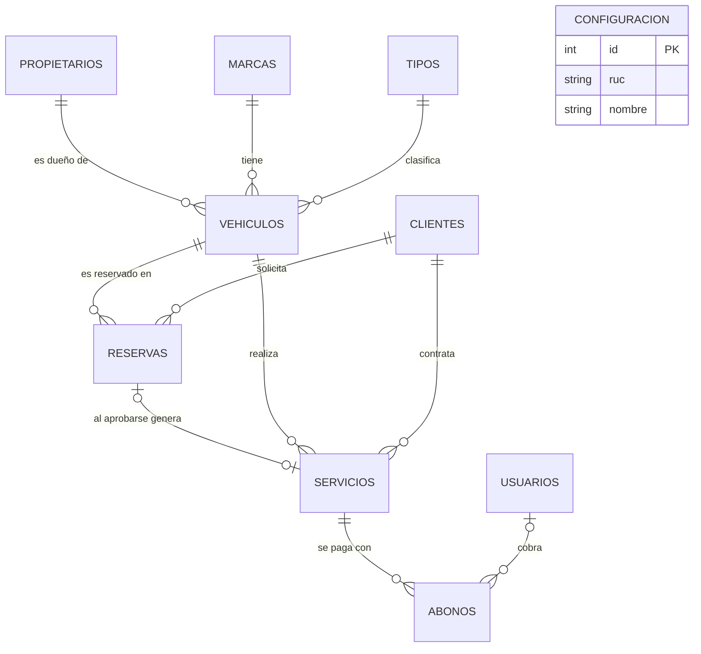
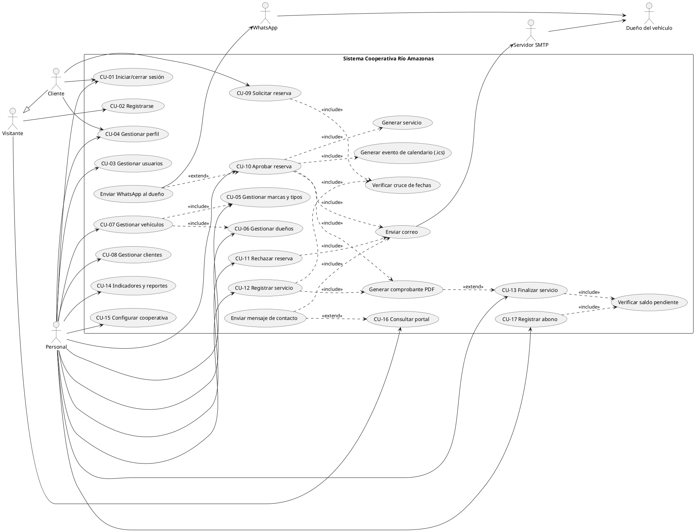

# Estado actual del sistema: Cooperativa Río Amazonas

**Fecha de corte:** 2026-11-27 · **Rama:** `main` (commit `e605147`)
**Propósito:** describir el sistema **tal como está hoy en el código**, para actualizar el documento de tesis y estructurar requisitos, casos de uso e historias de usuario.

Documentos relacionados:
- [`flujo-ejecucion.md`](flujo-ejecucion.md): recorrido `index.php` → controlador → modelo → vista, con números de línea.
- [`cambios-documento-word.md`](cambios-documento-word.md): reemplazos de términos y cambios por capítulo del Word.
- [`correcciones.md`](correcciones.md): plan del tutor.
- [`sql/`](sql/): migraciones de base de datos posteriores al script original.

---

## 1. Resumen

Sistema web para la gestión de **reservas (turnos) y servicios de transporte pesado** de la cooperativa:
- **Personal:** administra la flota (vehículos, marcas, tipos y sus dueños), los clientes, los servicios y **los pagos (abonos)** de cada servicio.
- **Clientes:** se registran desde la página pública con su **cédula**, consultan la disponibilidad de cada vehículo en un calendario y solicitan reservas indicando el punto del trabajo.
- **Respuesta a una reserva:** el personal la aprueba o la rechaza con un motivo.
  - Al **aprobarla**, el sistema crea automáticamente el **servicio** de esa reserva.
  - El cliente recibe un correo con un evento de calendario y el **comprobante PDF** del servicio.
  - El dueño del vehículo recibe un correo con un evento de calendario y un mensaje de WhatsApp.
- **Cobro:** el servicio se paga con uno o varios **abonos**. Solo se finaliza cuando está **pagado en su totalidad**.

**Flujo principal:** reserva (pendiente) → aprobación → servicio (en curso) → abonos → servicio finalizado (saldo 0).

| Aspecto | Valor |
|---|---|
| Lenguaje / BD | PHP 8.0.3 + MariaDB 10.4 (PDO, consultas preparadas, `utf8mb4`) |
| Arquitectura | MVC propio sin framework, monolítico en un solo servidor Apache (XAMPP) |
| Frontend | HTML + Bootstrap, jQuery, jQuery UI (autocompletar), DataTables, FullCalendar, Chart.js, Alertify / SweetAlert |
| Librerías servidor | PHPMailer (correo SMTP con adjuntos), FPDF (PDF) |
| Integraciones | Correo SMTP; evento de calendario iCalendar (.ics); comprobante PDF adjunto; WhatsApp por enlace `wa.me` |
| Zona horaria | `America/Guayaquil` (fijada en `index.php`) |
| Controladores / Modelos | 18 / 15 + la clase padre `ReglasTransporte` |
| Tablas | 10 (`usuarios`, `clientes`, `propietarios`, `vehiculos`, `marcas`, `tipos`, `reservas`, `servicios`, **`abonos`**, `configuracion`) |

---

## 2. Actores

| Actor | Cómo se identifica | Qué puede hacer |
|---|---|---|
| **Visitante** | Sin sesión | Ver el sitio público (inicio, beneficios, maquinaria, precios, contacto), registrarse como cliente con su cédula, enviar un mensaje de contacto. |
| **Cliente** | Tabla `clientes`, `$_SESSION['tipo'] = 2`; entra con su **correo** | Consultar la disponibilidad de los vehículos, solicitar reservas indicando el punto del trabajo, gestionar su perfil y contraseña, cerrar sesión. Recibe por correo la aprobación (con evento de calendario y comprobante PDF) o el rechazo (con motivo). |
| **Personal (administrador)** | Tabla `usuarios`, `$_SESSION['tipo'] = 1`; entra con **usuario o correo** | Aprobar o rechazar reservas; registrar servicios, **registrar abonos** y finalizar servicios pagados; gestionar vehículos, dueños, marcas, tipos, clientes, usuarios y configuración; ver indicadores y reportes. |
| **Dueño del vehículo** (actor secundario) | Tabla `propietarios`; **no inicia sesión** | Recibe por correo (con evento de calendario) y por WhatsApp el aviso de cada reserva aprobada de su vehículo: fecha, hora, duración, punto de trabajo y contacto del cliente. |
| **Servidor de correo (SMTP)** | Actor secundario | Entrega los correos de aprobación, rechazo y contacto. |
| **WhatsApp** | Actor secundario | Recibe el mensaje que el personal envía al dueño mediante el enlace `wa.me`. |

El inicio de sesión **detecta el perfil automáticamente**: primero busca en `usuarios`, luego en `clientes`. El usuario no elige su rol.

---

## 3. Arquitectura (resumen)

```
Navegador ──► .htaccess ──► index.php ──► Controllers/X.php ──► Models/XModel.php ──► Query (PDO) ──► MariaDB
                              │                │                       │
                              │                │                       └──► Correo (PHPMailer) ──► SMTP
                              │                └──► Views::getView() ──► Views/x/*.php ──► Templates (header/footer)
                              └──► verificación CSRF · errores de URL → página de error
```

| Capa | Responsabilidad |
|---|---|
| `index.php` | Punto de entrada único. Hace cuatro cosas: <ul><li>fija la zona horaria;</li><li>separa la URL en controlador / método / parámetros y solo ejecuta métodos públicos;</li><li>**verifica el token CSRF** en las peticiones POST y en las acciones `eliminar`, `finalizar` y `aprobar`;</li><li>si un parámetro de la URL no es válido (`TypeError`), muestra la página de error.</li></ul> |
| Controlador | Valida sesión y rol, recibe datos (`$_POST`, URL), llama al modelo y responde con una vista o JSON. **No contiene reglas de negocio ni SQL.** |
| Modelo | Bloque **"REGLAS DE NEGOCIO"**: validaciones, duplicados, tarifas, cruce de fechas, fotos, rechazo, notificaciones, calendario .ics, enlace de WhatsApp, abonos y saldos.<br>Bloque **"ACCESO A DATOS"**: SQL con `?`. |
| Vista | Muestra `$data`. No consulta la base de datos. Cada vista incluye su header/footer. **Los PDF también son vistas** (`Views/servicios/pdf-comprobante.php`, `pdf-reporte.php`). |
| `Config/App/` | Clases base: `Controller`, `Views`, `Query`, `Conexion`, `Correo`, `Autoload`. |
| `Config/Helpers.php` | Funciones comunes: `escapar()` / `escaparFilas()` (XSS), `tokenCsrf()` / `csrfValido()`, `validarImagen()`, `textoPdf()`, `pdfComoTexto()` (PDF para adjuntar), `cargarHeader()` / `cargarFooter()`. |

**Herencia de los modelos de reservas y servicios.** Las reglas que comparten se escriben una sola vez en `ReglasTransporte`:

```
Query (acceso a la base de datos)
  └── ReglasTransporte   validarCantidad, calcularTarifa, calcularTotal, buscarCruceDeFechas,
        │                registrarServicio, calcularSaldoPendiente, datosComprobante,
        │                resumenServicioDeReserva, getAbonos, getServicio, getEmpresa
        ├── ReservasModel
        └── ServiciosModel
```

Plantillas:
- **Personal:** `Templates/header.php` + `footer.php`.
- **Cliente:** `Templates/header-cliente.php` + `footer-cliente.php`.
- **Sitio público:** `Templates/header1.php` + `portada.php` + `footer1.php`.

---

## 4. Modelo de datos actual

### 4.1 Tablas

| Tabla | Campos | Estados |
|---|---|---|
| `usuarios` | id, usuario, nombre, apellido, correo, telefono, direccion, perfil (foto), clave (SHA-256), fecha, estado | 1 activo · 0 baja |
| `clientes` | id, dni, nombre, correo, codphone, telefono, direccion, clave (SHA-256, opcional), fecha, estado | 1 activo · 0 baja |
| `propietarios` | id, cedula, nombre, correo, celular, estado, fecha | 1 activo · 0 baja |
| `vehiculos` | id, placa, precio_hora, precio_dia, precio_mes, modelo, kilometraje, transmision, asientos, peso_carga_max, combustible, foto, estado, fecha, id_tipo, id_marca, id_propietario | 1 activo · 2 en servicio (*) · 0 baja |
| `marcas` | id, marca, estado, fecha | 1 activa · 0 baja |
| `tipos` | id, tipo, estado, fecha | 1 activo · 0 baja |
| `reservas` | id, f_inicio, f_fin, cantidad, tipo_precio, monto, f_reserva, observacion, direccion_trabajo, estado, motivo_rechazo, id_vehiculo, id_cliente | **0 pendiente · 1 aprobada · 2 rechazada** |
| `servicios` | id, cantidad, tipo_precio, monto, abono, fecha_inicio, fecha_fin, observacion, estado, id_cliente, id_vehiculo, **id_reserva** | 1 en curso · 0 finalizado |
| **`abonos`** (nueva) | id, monto, fecha, id_servicio, id_usuario | — |
| `configuracion` | id, ruc, nombre, telefono, correo, direccion, mensaje (pie del comprobante), logo | registro único |

**Valores y campos especiales:**
- `tipo_precio`: **1** = por hora · **2** = por día · **3** = por mes.
- `monto` guarda el **precio unitario** vigente al registrar. **Total** = cantidad × monto.
- `servicios.abono` guarda la **suma** de los abonos del servicio. Se recalcula después de cada pago, así que nunca se descuadra con la tabla `abonos`.
- `servicios.id_reserva`: la reserva de la que salió el servicio. Es NULL en los servicios registrados a mano.
- `abonos.id_usuario`: quién cobró. Es NULL en los abonos migrados, porque no se sabe quién los cobró.
- `direccion_trabajo` e `id_propietario` son NULL en los registros anteriores a la migración 02. En los nuevos los exige el modelo.
- (*) El estado 2 de los vehículos solo se muestra en la tabla ("En servicio"); hoy ningún proceso lo asigna (ver §9).

**Estado de una reserva frente al de su servicio:**
- La reserva conserva su estado de **respuesta**: aprobada o rechazada.
- La **ejecución y los pagos** los lleva el servicio: en curso o finalizado, abonado y pendiente.
- La pantalla de la reserva muestra los dos.

### 4.2 Relaciones



- **Claves foráneas originales:** `ON DELETE CASCADE ON UPDATE CASCADE`. También `abonos.id_servicio`: si se borrara un servicio, se borran sus pagos.
- **`ON DELETE SET NULL`:** `vehiculos.id_propietario`, `servicios.id_reserva` y `abonos.id_usuario`. Si se borrara el registro relacionado, se pierde el enlace, pero el registro se conserva.
- **Borrado lógico:** en la aplicación **nunca se borra**; los registros se dan de baja con `estado = 0`.
- **Sin relaciones:** `configuracion`.

### 4.3 Migraciones

| Archivo | Cambios |
|---|---|
| `sql/01_rechazo_reservas.sql` | `reservas.motivo_rechazo` (estado 2 = rechazada) |
| `sql/02_propietarios_y_punto_trabajo.sql` | Tabla `propietarios`, `vehiculos.id_propietario` (FK), `reservas.direccion_trabajo` |
| `sql/03_servicios_de_reservas_aprobadas.sql` | Crea el servicio de las reservas que se aprobaron **antes** de que aprobar lo hiciera automáticamente. Solo datos, sin cambios de estructura, y no duplica si se ejecuta dos veces. |
| `sql/04_abonos.sql` | Tabla `abonos` (FK a `servicios` y `usuarios`); pasa los abonos existentes al historial |
| `sql/05_reserva_en_servicios.sql` | `servicios.id_reserva` (FK a `reservas`); enlaza los servicios ya creados |

Las migraciones 01 y 02 están también al final de `coop_rio_amazonas.sql`. **Las 03, 04 y 05 no**: en una instalación nueva hay que ejecutarlas en orden después del script principal.

---

## 5. Módulos y funcionalidades (inventario para trazabilidad)

Cada módulo indica: pantalla/URL, actor, archivos MVC, métodos y tablas.
Las URL son relativas a `http://localhost/coop_rio_amazonas/`.

### M1. Autenticación
| | |
|---|---|
| Actor | Personal, Cliente |
| Pantalla | `login` → `Views/login.php` · JS `Assets/js/login.js` |
| Controlador | `Login`: `index()`, `validar()`, `salir()` (cierra sesión de personal **y** cliente) |
| Modelo | `LoginModel::autenticar()`: valida campos, cifra la clave, busca primero en personal y luego en clientes, solo cuentas activas |
| Tablas | `usuarios`, `clientes` (lectura) |
| Notas | <ul><li>Al entrar regenera el id de sesión.</li><li>Al salir vacía la sesión, borra la cookie y destruye la sesión.</li><li>Si ya hay sesión, `login` envía a `dashboard` (el cliente termina en `reservas`).</li></ul> |

### M2. Registro público de clientes
| | |
|---|---|
| Actor | Visitante |
| Pantalla | Inicio (`/`) → `Views/index.php`, formulario de registro con **cédula** · JS `Assets/major/js/pages/index.js` |
| Controlador | `Major`: `index()`, `verify()` |
| Modelo | `MajorModel::registrarCliente()` |
| Tablas | `clientes` (INSERT o UPDATE) |
| Reglas | RN-01, RN-02, RN-03 |
| Nota | Si el personal ya había registrado al cliente (misma cédula, sin correo) y el teléfono coincide, el registro web **completa esa cuenta** en lugar de crear un duplicado. |

### M3. Gestión de usuarios del personal
| | |
|---|---|
| Actor | Personal |
| Pantalla | `usuarios` → `Views/usuarios/index.php` · JS `pages/usuarios.js` |
| Controlador | `Usuarios`: `index()`, `listar()`, `registrar()`, `editar($id)`, `eliminar($id)` |
| Modelo | `UsuariosModel`: `guardar()`, `darDeBaja()`, `getUsuarios()`, `getUsuario()` |
| Tablas | `usuarios` |
| Reglas | RN-01, RN-04, RN-05, RN-06 |

### M4. Perfil propio
| | Personal | Cliente |
|---|---|---|
| Pantalla | `usuarios/perfil` → `Views/usuarios/perfil.php` · `pages/perfil.js` | `clientes/perfil` → `Views/clientes/perfil.php` · `pages/perfilcliente.js` |
| Controlador | `Usuarios`: `perfil()`, `actualizarDato()`, `cambiarPass()` | `Clientes`: `perfil()`, `actualizarDato()`, `cambiarPass()` |
| Modelo | `UsuariosModel`: `actualizarPerfil()` (incluye foto), `cambiarClave()` | `ClientesModel`: `actualizarPerfil()`, `cambiarClave()` |
| Tablas | `usuarios` | `clientes` |
| Reglas | RN-01, RN-04, RN-07, RN-08 | RN-01, RN-07, RN-09 |

### M5. Catálogos de apoyo: marcas y tipos de vehículo
| | Marcas | Tipos |
|---|---|---|
| Actor | Personal | Personal |
| Pantalla | `marcas` → `Views/vehiculos/marcas.php` · `pages/marcas.js` | `tipos` → `Views/vehiculos/tipos.php` · `pages/tipos.js` |
| Controlador | `Marcas`: `index/listar/registrar/editar/eliminar` | `Tipos`: igual |
| Modelo | `MarcasModel`: `guardar()`, `darDeBaja()` | `TiposModel`: `guardar()`, `darDeBaja()` |
| Tablas | `marcas` (+ lectura de `vehiculos`) | `tipos` (+ lectura de `vehiculos`) |
| Reglas | RN-10, RN-11 | RN-10, RN-11 |

### M6. Gestión de dueños de vehículos
| | |
|---|---|
| Actor | Personal |
| Pantalla | `propietarios` → `Views/propietarios/index.php` · `pages/propietarios.js` (menú **Vehículos → Dueños**) |
| Controlador | `Propietarios`: `index()`, `listar()`, `registrar()`, `editar($id)`, `eliminar($id)` |
| Modelo | `PropietariosModel`: `guardar()`, `darDeBaja()`, `getPropietarios()` (incluye cuántos vehículos activos tiene) |
| Tablas | `propietarios` (+ lectura de `vehiculos`) |
| Reglas | RN-31, RN-32, RN-33 |

### M7. Gestión de vehículos (flota)
| | |
|---|---|
| Actor | Personal |
| Pantalla | `vehiculos` → `Views/vehiculos/index.php` · `pages/vehiculos.js` |
| Controlador | `Vehiculos`: `index()`, `listar()`, `registrar()`, `editar($id)`, `eliminar($id)`, `buscarVehiculo()` (autocompletar de Servicios) |
| Modelo | `VehiculosModel`: `guardar()`, `darDeBaja()`, `sugerencias()` |
| Tablas | `vehiculos` (lee `marcas`, `tipos` y `propietarios`) |
| Reglas | RN-12, RN-13, RN-14, RN-34 |

### M8. Gestión de clientes
| | |
|---|---|
| Actor | Personal |
| Pantalla | `clientes` → `Views/clientes/index.php` · `pages/clientes.js` |
| Controlador | `Clientes`: `index()`, `listar()`, `registrar()`, `editar($id)`, `eliminar($id)`, `buscarCliente()` (autocompletar de Servicios) |
| Modelo | `ClientesModel`: `guardar()`, `darDeBaja()`, `sugerencias()` |
| Tablas | `clientes` |
| Reglas | RN-15 |
| Nota | Un cliente registrado por el personal **no tiene contraseña ni correo**. Para iniciar sesión se registra por la web con la **misma cédula** y su teléfono (ver M2). |

### M9. Reservas (solicitud de turno)
| | |
|---|---|
| Actores | Cliente (solicita); Personal (consulta, aprueba o rechaza); Dueño, SMTP y WhatsApp (reciben avisos) |
| Pantalla `reservas` | `Views/reservas/index.php` · `pages/reservas.js`<ul><li>Lista de vehículos y calendario FullCalendar.</li><li>Formulario con **punto de trabajo** (solo cliente).</li><li>El personal hace clic en un evento para abrir su detalle.</li></ul> |
| Pantalla `reservas/verify/{id}` | `Views/reservas/verify.php` · `pages/verify.js`<ul><li>Detalle con duración, punto de trabajo, dueño y total.</li><li>Botones **Aprobar** / **Rechazar** (ventana de motivo).</li><li>En las aprobadas: botón **Enviar WhatsApp al dueño** y **estado del servicio** (en curso o finalizado, abonado, pendiente, enlace al comprobante PDF).</li></ul> |
| Controlador | `Reservas`: `index()`, `listar($id_vehiculo)` (eventos del calendario), `getVehiculo($id)`, `solicitar()`, `verify($id)`, `aprobar($id)`, `rechazar($id)` |
| Modelo | `ReservasModel` (hereda de `ReglasTransporte`): `solicitar()`, `getEventosCalendario()`, `aprobar()`, `rechazar()`, `motivosRechazo()`, `textoDuracion()`, `generarIcs()`, `enlaceWhatsapp()`, `getDetalleReserva()`, `getClienteActivo()` |
| Tablas | `reservas` (INSERT/UPDATE), `servicios` (INSERT al aprobar); lee `vehiculos`, `propietarios`, `marcas`, `tipos`, `clientes`, `abonos`, `configuracion` |
| Reglas | RN-16 a RN-21, RN-35 a RN-42 |
| Notificación interna | La campana del panel del personal muestra el **total de reservas pendientes**, las 5 más recientes y un enlace "Ver las N pendientes en el calendario" (`getNuevasReservas()`, cargada por la clase base `Controller`). |

### M10. Servicios de transporte y abonos
| | |
|---|---|
| Actor | Personal |
| Pantalla | `servicios` → `Views/servicios/index.php` · `pages/servicios.js`:<ul><li>tabla de servicios;</li><li>formulario con autocompletado de cliente y vehículo;</li><li>ventana **Abonos** (botón **$**): total, abonado, pendiente, historial de pagos y campo para un nuevo abono;</li><li>ventana **Finalizar**.</li></ul> |
| Controlador | `Servicios`: `index()`, `registrar()`, `listar()`, `ver($id)`, **`abonos($id)`**, **`registrarAbono($id)`**, `finalizar($id)`, `pdfServicio($id)` (comprobante), `reporte()` (PDF general) |
| Modelo | `ServiciosModel` (hereda de `ReglasTransporte`): `registrar()`, `registrarAbono()`, `datosAbonos()`, `insertarAbono()`, `finalizar()`, `datosReporte()`, `getTodosLosAbonos()`, `textoEstado()` · heredados: `calcularTarifa()`, `buscarCruceDeFechas()`, `calcularSaldoPendiente()`, `datosComprobante()` |
| Vistas PDF | `Views/servicios/pdf-comprobante.php` (comprobante con historial de abonos), `Views/servicios/pdf-reporte.php` |
| Tablas | `servicios` (INSERT/UPDATE), `abonos` (INSERT); lee `vehiculos`, `clientes`, `tipos`, `reservas`, `usuarios`, `configuracion` |
| Reglas | RN-17, RN-18, RN-22 a RN-25, RN-43, RN-44 |
| Nota | Al registrar un servicio se abre automáticamente su comprobante PDF. |

### M11. Panel de indicadores y reportes
| | |
|---|---|
| Actor | Personal |
| Pantalla | `dashboard` → `Views/dashboard/home.php` · `Assets/js/chart.js` |
| Controlador | `Dashboard`: `index()`, `ingresosMes()`, `ingresosSemana()` · `Servicios::reporte()` (menú **Reportes**) |
| Modelo | `DashboardModel`: `getDatos($tabla)` (conteos), `ingresosAnioActual()`, `ingresosSemana()` · `ServiciosModel::datosReporte()` |
| Tablas | Conteos de `usuarios`, `clientes`, `vehiculos`, `tipos`, `marcas`; ingresos de `servicios`; pagos de `abonos` |
| Reglas | RN-26, RN-45 |

### M12. Configuración de la cooperativa
| | |
|---|---|
| Actor | Personal |
| Pantalla | `empresa` → `Views/dashboard/index.php` · `pages/dashboard.js` (menú **Configuración**) |
| Controlador | `Empresa`: `index()`, `modificar()` |
| Modelo | `EmpresaModel::actualizar()` |
| Tablas | `configuracion` |
| Reglas | RN-27, RN-28 |
| Uso | Nombre, RUC, contacto y mensaje aparecen en los PDF y en los correos (nombre del remitente y "Responder a"). |

### M13. Sitio público
| Página | URL | Controlador / Modelo | Contenido |
|---|---|---|---|
| Inicio | `/` | `Major` / `MajorModel` | Portada y registro de clientes (M2) |
| Beneficios | `services` | `Services` | Estático |
| Sobre nosotros | `about` | `About` | Estático |
| Maquinaria | `cars`, `cars/single/{id}` | `Cars` / `CarsModel` | Vehículos no dados de baja y ficha individual (un id inexistente lleva a la página de error) |
| Precios | `pricing` | `Pricing` / `PricingModel` | Tarifas por hora, día y mes de los vehículos activos |
| Contacto | `contact` | `Contact` / `ContactModel::enviarMensaje()` | Formulario que envía un correo a la cooperativa (RN-29) |
| Error | `errors` | `Errors` | Página para rutas inexistentes o parámetros inválidos |

---

## 6. Catálogo de reglas de negocio (implementadas)

Úsalas como **criterios de aceptación**. Todas están en el modelo indicado.

| Código | Regla | Modelo / método |
|---|---|---|
| RN-01 | Los campos obligatorios no pueden estar vacíos; el correo debe tener un formato válido. | Todos los `guardar()`, `registrarCliente()`, `actualizarPerfil()` |
| RN-02 | **El cliente se identifica por su cédula** (10 dígitos), en tres casos: <ul><li>La cédula ya tiene cuenta con correo: "Ya tienes una cuenta".</li><li>La registró el personal sin correo y el teléfono coincide: se completa esa cuenta.</li><li>Si no coincide: se pide contactar a la cooperativa.</li></ul> | `MajorModel::registrarCliente()` |
| RN-03 | Contraseña del cliente: al menos **6 caracteres**, igual a su confirmación, guardada cifrada (SHA-256). | `MajorModel::registrarCliente()`, `ClientesModel::cambiarClave()` |
| RN-04 | El usuario y el correo del personal no pueden pertenecer a otra persona (al registrar y al modificar). | `UsuariosModel::guardar()`, `actualizarPerfil()` |
| RN-05 | Contraseña del personal: obligatoria al registrar, al menos **8 caracteres** y confirmada. | `UsuariosModel::guardar()`, `cambiarClave()` |
| RN-06 | Un usuario no puede darse de baja a sí mismo. | `UsuariosModel::darDeBaja()` |
| RN-07 | Para cambiar la contraseña se exige la actual correcta y la nueva confirmada (comparación exacta). | `UsuariosModel::cambiarClave()`, `ClientesModel::cambiarClave()` |
| RN-08 | Foto de perfil: png/jpg/jpeg de hasta 2 MB, y se valida que **el contenido sea realmente una imagen**. La anterior se borra solo si se guardó con éxito. | `UsuariosModel::actualizarPerfil()`, `validarImagen()` |
| RN-09 | El correo y el DNI del cliente no pueden pertenecer a otro cliente. | `ClientesModel::actualizarPerfil()` |
| RN-10 | No puede haber dos marcas (o dos tipos) activos con el mismo nombre, tampoco al modificar. | `MarcasModel::guardar()`, `TiposModel::guardar()` |
| RN-11 | No se puede dar de baja una marca o tipo usado por vehículos activos. | `darDeBaja()` de Marcas y Tipos |
| RN-12 | La placa identifica al vehículo y no puede repetirse (al registrar y al modificar). | `VehiculosModel::guardar()` |
| RN-13 | Los precios por hora, día y mes deben ser números mayores a 0; los asientos, un entero positivo. | `VehiculosModel::guardar()` |
| RN-14 | Foto del vehículo: png/jpg/jpeg validada por contenido (RN-08). Si no se sube, se conserva la actual; si se quita, se usa la imagen por defecto. La anterior se borra solo tras guardar con éxito. | `VehiculosModel::guardar()` |
| RN-15 | El DNI identifica al cliente y no puede repetirse. | `ClientesModel::guardar()` |
| RN-16 | Para reservar: <ul><li>no se acepta una fecha/hora pasada (hora de Ecuador);</li><li>la cantidad es un **entero** mayor a 0 y no pasa del máximo de su tarifa (720 horas, 365 días o 12 meses);</li><li>la tarifa debe ser hora, día o mes;</li><li>el cliente debe estar activo.</li></ul> | `ReservasModel::solicitar()`, `validarCantidad()` |
| RN-17 | **Cálculo de tarifa:** fecha fin = fecha inicio + cantidad (horas, días o meses); el precio unitario es el del vehículo según la tarifa elegida; total = cantidad × precio, redondeado a centavos. | `ReglasTransporte::calcularTarifa()`, `calcularTotal()` |
| RN-18 | **Cruce de fechas:** dos periodos se cruzan si uno empieza antes de que el otro termine y termina después de que el otro empiece. Se comparan las reservas **pendientes o aprobadas** (las rechazadas liberan el horario) y los servicios en curso. Un vehículo ocupado no se puede reservar ni asignar. | `ReglasTransporte::buscarCruceDeFechas()` |
| RN-19 | Toda reserva nueva queda **pendiente** (estado 0) hasta que el personal la aprueba (1) o la rechaza (2). | `ReservasModel::solicitar()`, `aprobar()`, `rechazar()` |
| RN-20 | Al aprobar se notifica por correo al cliente y al dueño (ver RN-38). Si un correo falla, la reserva queda aprobada igual y se informa qué aviso no salió. | `ReservasModel::aprobar()` |
| RN-21 | **Privacidad del calendario:** <ul><li>El personal ve el nombre de todos los clientes.</li><li>Un cliente solo ve su nombre en sus reservas; las demás aparecen como "RESERVADO".</li><li>El navegador solo recibe título, fechas y color, sin datos personales.</li><li>Colores: rojo pendiente, verde aprobada, gris rechazada. La rechazada solo la ven el personal y el cliente que la solicitó.</li></ul> | `ReservasModel::getEventosCalendario()` |
| RN-22 | Para registrar un servicio son obligatorios el cliente, el vehículo, la cantidad, la tarifa, el abono y la fecha. Además: <ul><li>la cantidad cumple RN-16;</li><li>la fecha no es anterior a hoy;</li><li>el cliente y el vehículo deben estar activos;</li><li>el abono es un número de 0 en adelante con hasta 2 decimales (acepta coma o punto) y **no supera el total**.</li></ul> | `ServiciosModel::registrar()` |
| RN-23 | Al registrar un servicio no se consideran como cruce las reservas **del mismo cliente** (es la reserva que se está concretando) ni las rechazadas; sí las de otros clientes y los servicios en curso. | `buscarCruceDeFechas()` |
| RN-24 | **Saldo pendiente** = cantidad × precio unitario − suma de abonos, para cualquier estado del servicio. | `ReglasTransporte::calcularSaldoPendiente()` |
| RN-25 | Un servicio nace **en curso** (estado 1) y solo se **finaliza** (estado 0) si existe, sigue en curso y su **saldo pendiente es 0**. Si falta dinero: "No se puede finalizar: falta pagar $X". | `ServiciosModel::finalizar()` |
| RN-26 | Ingresos = Σ (cantidad × monto) de los servicios según su fecha de inicio; mensual del año actual y semanal de la semana actual (lunes a domingo). | `DashboardModel` |
| RN-27 | El RUC solo admite dígitos y se guarda como texto (conserva el 0 inicial). | `EmpresaModel::actualizar()` |
| RN-28 | El logo debe ser PNG (validado por contenido); se valida antes de guardar cualquier dato. | `EmpresaModel::actualizar()` |
| RN-29 | El mensaje de contacto exige todos los campos y un correo válido; el texto se escapa (sin HTML) y la respuesta va al correo del visitante. | `ContactModel::enviarMensaje()` |
| RN-30 | **Control de acceso:** <ul><li>los módulos de gestión son solo para el personal;</li><li>el perfil de cliente es solo para clientes;</li><li>las acciones protegidas terminan con `exit` tras redirigir;</li><li>los cambios exigen el token CSRF de la sesión.</li></ul> | Constructores de controladores, `index.php` |
| RN-31 | Dueño: la cédula tiene 10 dígitos (o 13 si es RUC); correo válido; celular de 9 a 15 dígitos (se guardan solo los dígitos). | `PropietariosModel::guardar()` |
| RN-32 | La cédula y el correo de un dueño no pueden pertenecer a otro dueño activo (al registrar y al modificar). | `PropietariosModel::guardar()` |
| RN-33 | No se puede dar de baja a un dueño que tiene vehículos activos. | `PropietariosModel::darDeBaja()` |
| RN-34 | Todo vehículo debe tener un dueño activo asignado al registrarlo o modificarlo. | `VehiculosModel::guardar()` |
| RN-35 | La reserva exige la **dirección o punto del trabajo** (mínimo 5 caracteres). | `ReservasModel::solicitar()` |
| RN-36 | Solo un cliente (tipo 2) puede solicitar reservas. | `Reservas::solicitar()` |
| RN-37 | Solo se puede responder (aprobar o rechazar) una reserva **pendiente**; una aprobada o rechazada ya no cambia. No se aprueba si el vehículo o el cliente fueron dados de baja: en ese caso se debe rechazar. | `ReservasModel::aprobar()`, `rechazar()` |
| RN-38 | **Aviso de aprobación:** el cliente y el dueño reciben un correo con un **evento de calendario .ics** que tiene recordatorio 1 hora antes. <ul><li>El correo trae el detalle: vehículo, fecha, hora, duración y punto de trabajo.</li><li>Al dueño se le añade el contacto del cliente.</li><li>Al cliente se le adjunta además el comprobante PDF (RN-42).</li></ul> | `ReservasModel::notificarCliente()`, `notificarPropietario()`, `generarIcs()` |
| RN-39 | **WhatsApp al dueño:** se genera un enlace `wa.me` al celular del dueño con código de país 593 (0987654321 → 593987654321) y el mensaje ya escrito (fecha, hora, duración, punto de trabajo, cliente, detalle). | `ReservasModel::enlaceWhatsapp()` |
| RN-40 | **Rechazo:** el motivo debe ser de la lista (No realizó el pago, El cliente solicitó cancelar, Vehículo no disponible, Otro); "Otro" exige detalle (mínimo 5 caracteres). Se guarda el motivo y se envía un correo al cliente. | `ReservasModel::rechazar()` |
| RN-41 | **Aprobar crea el servicio:** al aprobar una reserva se registra su servicio con los mismos datos, en curso y con abono 0, enlazado por `id_reserva`. Si el servicio no se puede crear, la reserva vuelve a pendiente para no quedar a medias. | `ReservasModel::aprobar()`, `ReglasTransporte::registrarServicio()` |
| RN-42 | **Comprobante en el correo:** el correo de aprobación al cliente adjunta el comprobante PDF del servicio (el mismo que ve el personal). Si el PDF no se puede generar, el correo sale igual con el .ics. | `ReservasModel::notificarCliente()`, `pdfComoTexto()` |
| RN-43 | **Abonos:** un pago parcial debe ser un número mayor a 0 (hasta 2 decimales) y no superar el saldo pendiente. No se aceptan pagos si el servicio ya está pagado. <ul><li>Cada pago guarda fecha y usuario que lo cobró.</li><li>`servicios.abono` se recalcula como la suma de los pagos.</li><li>El abono inicial del formulario también queda en el historial.</li></ul> | `ServiciosModel::registrarAbono()`, `insertarAbono()` |
| RN-44 | **Seguimiento desde la reserva:** el detalle de una reserva aprobada muestra el estado de su servicio, lo abonado, lo pendiente y el enlace al comprobante. | `ReglasTransporte::resumenServicioDeReserva()` |
| RN-45 | **Reporte de servicios:** por servicio, precio, total y pagado; totales de lo facturado, lo pagado y lo **pendiente por cobrar**; detalle de cada abono (fecha, servicio, cliente, quién cobró, monto) y **total pagado**. | `ServiciosModel::datosReporte()`, `Views/servicios/pdf-reporte.php` |

---

## 7. Propuesta de estructura: épicas → RF → CU → HU

> Propuesta derivada del código actual. Ajusta nombres y numeración a tu documento. Se mantiene **trazabilidad 1 a 1** entre RF, CU y HU, como pidió el tutor.

### 7.1 Épicas (módulos principales)

| Épica | Nombre | Módulos |
|---|---|---|
| E1 | Gestión de acceso y cuentas | M1, M2, M3, M4 |
| E2 | Gestión de flota, dueños y catálogos de apoyo | M5, M6, M7 |
| E3 | Gestión de clientes | M8 |
| E4 | Gestión de reservas (turnos) y notificaciones | M9 |
| E5 | Gestión de servicios de transporte y cobros | M10 |
| E6 | Reportes y configuración | M11, M12 |
| E7 | Portal público | M13 |

### 7.2 Requisitos funcionales, casos de uso e historias (1 a 1)

| RF | "El sistema debe permitir…" | CU | HU | Épica | Prioridad (MoSCoW) |
|---|---|---|---|---|---|
| RF-01 | …iniciar y cerrar sesión detectando automáticamente si es personal o cliente. | CU-01 | HU-01 | E1 | Must |
| RF-02 | …que un visitante se registre como cliente con su cédula, correo y contraseña. | CU-02 | HU-02 | E1 | Must |
| RF-03 | …al personal registrar, modificar, listar y dar de baja usuarios del personal. | CU-03 | HU-03 | E1 | Must |
| RF-04 | …a cada usuario actualizar sus datos de perfil y cambiar su contraseña. | CU-04 | HU-04 | E1 | Should |
| RF-05 | …al personal gestionar los catálogos de apoyo de marcas y tipos de vehículo. | CU-05 | HU-05 | E2 | Must |
| RF-06 | …al personal registrar, modificar, listar y dar de baja a los dueños de los vehículos con su correo y celular. | CU-06 | HU-06 | E2 | Must |
| RF-07 | …al personal registrar, modificar, listar y dar de baja vehículos con su dueño, tarifas y foto. | CU-07 | HU-07 | E2 | Must |
| RF-08 | …al personal registrar, modificar, listar y dar de baja clientes. | CU-08 | HU-08 | E3 | Must |
| RF-09 | …al cliente consultar la disponibilidad de un vehículo en un calendario y solicitar una reserva indicando el punto del trabajo. | CU-09 | HU-09 | E4 | Must |
| RF-10 | …al personal aprobar reservas pendientes, generando su servicio y notificando al cliente (correo con calendario y comprobante PDF) y al dueño (correo con calendario y WhatsApp). | CU-10 | HU-10 | E4 | Must |
| RF-11 | …al personal rechazar reservas pendientes indicando el motivo y notificando al cliente. | CU-11 | HU-11 | E4 | Must |
| RF-12 | …al personal registrar un servicio de transporte verificando la disponibilidad del vehículo. | CU-12 | HU-12 | E5 | Must |
| RF-13 | …al personal finalizar servicios pagados en su totalidad y emitir su comprobante en PDF. | CU-13 | HU-13 | E5 | Should |
| RF-14 | …al personal consultar indicadores, gráficos de ingresos y el reporte PDF de servicios y pagos. | CU-14 | HU-14 | E6 | Should |
| RF-15 | …al personal configurar los datos y el logo de la cooperativa. | CU-15 | HU-15 | E6 | Could |
| RF-16 | …a los visitantes consultar la maquinaria, las tarifas y enviar un mensaje de contacto. | CU-16 | HU-16 | E7 | Could |
| RF-17 | …al personal registrar abonos (pagos parciales) de un servicio y consultar su historial de pagos. | CU-17 | HU-17 | E5 | Must |

### 7.3 Historias de usuario con criterios de aceptación

**HU-01 Iniciar y cerrar sesión**: *Como personal o cliente, quiero iniciar sesión con mis credenciales para acceder a las funciones de mi perfil.*
- Con campos vacíos, muestra "Todo los campos son requeridos".
- Con credenciales incorrectas o cuenta dada de baja, muestra "Usuario o contraseña incorrecta".
- El personal entra con usuario o correo y llega al panel; el cliente entra con su correo y llega a reservas.
- Al pulsar Salir (personal o cliente) se destruye la sesión y vuelve al login.
- *MVC:* `Login` / `LoginModel::autenticar()` / `Views/login.php` · *Tablas:* `usuarios`, `clientes`

**HU-02 Registro de cliente**: *Como visitante, quiero crear mi cuenta para poder solicitar reservas.*
- Exige cédula (10 dígitos), nombre, teléfono, correo, contraseña y dirección (RN-01).
- Rechaza correos inválidos, contraseñas de menos de 6 caracteres (RN-03) y cédulas que ya tienen cuenta (RN-02).
- Si el personal ya lo había registrado con esa cédula y el teléfono coincide, completa esa cuenta (RN-02).
- Con datos válidos muestra "Registrado con éxito" y luego puede iniciar sesión.
- *MVC:* `Major::verify()` / `MajorModel::registrarCliente()` / `Views/index.php` · *Tabla:* `clientes`

**HU-03 Gestionar usuarios del personal**: *Como administrador, quiero gestionar las cuentas del personal para controlar quién administra el sistema.*
- Lista los usuarios activos; permite registrar (contraseña de al menos 8 caracteres y confirmada, RN-05), editar y dar de baja.
- No permite usuario o correo repetidos (RN-04) ni darse de baja a sí mismo (RN-06).
- *MVC:* `Usuarios` / `UsuariosModel::guardar()`, `darDeBaja()` / `Views/usuarios/index.php` · *Tabla:* `usuarios`

**HU-04 Gestionar mi perfil**: *Como usuario, quiero actualizar mis datos y mi contraseña para mantener mi cuenta al día.*
- Actualiza los datos con validación de correo; el personal puede cambiar su foto (RN-08).
- El cambio de contraseña exige la actual correcta y la confirmación (RN-07).
- El cliente no puede usar el correo o el DNI de otro cliente (RN-09).
- *MVC:* `Usuarios`/`Clientes` → `perfil()`, `actualizarDato()`, `cambiarPass()` · *Tablas:* `usuarios`, `clientes`

**HU-05 Gestionar catálogos de apoyo (marcas y tipos)**: *Como administrador, quiero mantener las marcas y tipos de vehículo para clasificar la flota.*
- Registra, edita, lista y da de baja; no admite nombres repetidos (RN-10).
- No permite dar de baja una marca o tipo con vehículos activos (RN-11).
- *MVC:* `Marcas`/`Tipos` / `MarcasModel`/`TiposModel` / `Views/vehiculos/marcas.php`, `tipos.php` · *Tablas:* `marcas`, `tipos`

**HU-06 Gestionar dueños de vehículos**: *Como administrador, quiero registrar a los dueños de los vehículos con su correo y celular para que reciban los avisos de las reservas de su vehículo.*
- Registra, edita, lista y da de baja; la tabla muestra cuántos vehículos activos tiene cada dueño.
- Valida cédula (10 o 13 dígitos), correo y celular (RN-31); cédula y correo no se repiten (RN-32).
- No permite dar de baja a un dueño con vehículos activos (RN-33).
- *MVC:* `Propietarios` / `PropietariosModel::guardar()`, `darDeBaja()` / `Views/propietarios/index.php` · *Tabla:* `propietarios`

**HU-07 Gestionar vehículos**: *Como administrador, quiero registrar la flota con su dueño y sus tarifas para ofrecerla en reservas y servicios.*
- Exige todos los campos, incluido un **dueño activo** (RN-34); precios > 0 y asientos enteros (RN-13); placa única (RN-12).
- Permite subir, conservar o quitar la foto, validada por contenido (RN-14).
- La baja es lógica: el vehículo deja de aparecer en reservas, precios y servicios.
- *MVC:* `Vehiculos` / `VehiculosModel::guardar()` / `Views/vehiculos/index.php` · *Tablas:* `vehiculos`, `propietarios`

**HU-08 Gestionar clientes**: *Como administrador, quiero registrar clientes para asignarles servicios.*
- Registra y edita con DNI, nombre, teléfono y dirección; el DNI no se repite (RN-15).
- Lista los clientes activos y permite darlos de baja.
- *MVC:* `Clientes` / `ClientesModel::guardar()` / `Views/clientes/index.php` · *Tabla:* `clientes`

**HU-09 Solicitar reserva**: *Como cliente, quiero ver la disponibilidad de un vehículo y solicitar una reserva indicando dónde es el trabajo para asegurar mi turno.*
- Al elegir un vehículo se muestra su calendario: rojo pendiente, verde aprobada, gris rechazada; las reservas ajenas aparecen como "RESERVADO" (RN-21).
- Al hacer clic en una fecha se abre el formulario: hora, cantidad, tarifa, **dirección o punto del trabajo** (obligatoria, RN-35) y observación.
- Rechaza fechas pasadas, cantidades no enteras o fuera del máximo (RN-16) y periodos que se cruzan con otra reserva o servicio (RN-18), indicando el periodo ocupado.
- Si es válida, se registra como **pendiente** (RN-19) y aparece en el calendario.
- *MVC:* `Reservas::solicitar()` / `ReservasModel::solicitar()` / `Views/reservas/index.php` · *Tabla:* `reservas`

**HU-10 Aprobar reserva y notificar**: *Como administrador, quiero aprobar una reserva pendiente para confirmar el turno al cliente, avisar al dueño del vehículo y dejar listo su servicio.*
- La campana muestra el total de reservas pendientes; el detalle muestra cliente, fechas, duración, punto de trabajo, monto, total y dueño.
- Solo se aprueba una reserva pendiente con vehículo y cliente activos (RN-37); pasa a estado 1 (verde).
- Se crea el **servicio** de la reserva, en curso y con abono 0 (RN-41).
- Cliente y dueño reciben un correo con el detalle y un **evento de calendario .ics** (RN-38). El del cliente adjunta el **comprobante PDF** (RN-42).
- Se ofrece abrir **WhatsApp** con el mensaje para el dueño, y el botón queda disponible en el detalle (RN-39).
- El detalle de la reserva aprobada muestra el estado y los pagos de su servicio (RN-44).
- Si un correo falla, la reserva queda aprobada y se indica qué aviso no salió (RN-20).
- *MVC:* `Reservas::verify()`, `aprobar()` / `ReservasModel::aprobar()`, `generarIcs()`, `enlaceWhatsapp()` / `Views/reservas/verify.php` · *Tablas:* `reservas`, `servicios`, `propietarios`

**HU-11 Rechazar reserva con motivo**: *Como administrador, quiero rechazar una reserva indicando el motivo para informar al cliente y liberar el horario.*
- El botón Rechazar abre una ventana con la lista de motivos; "Otro" exige describirlo (RN-40).
- Solo se rechaza una reserva pendiente (RN-37); pasa a estado 2 y guarda el motivo.
- El cliente recibe un correo con el motivo.
- El horario queda libre para otras reservas y servicios (RN-18); en el calendario se ve en gris solo para el personal y ese cliente (RN-21).
- *MVC:* `Reservas::rechazar()` / `ReservasModel::rechazar()` / `Views/reservas/verify.php` · *Tabla:* `reservas`

**HU-12 Registrar servicio**: *Como administrador, quiero registrar un servicio de transporte para un cliente y un vehículo.*
- Busca cliente y vehículo por autocompletado; al elegir el vehículo se muestran sus tarifas.
- Exige todos los campos y valida cantidad, fecha y abono inicial (RN-22); calcula la fecha de fin y el total (RN-17).
- Rechaza si el vehículo está ocupado (RN-18, RN-23).
- Al registrar, el servicio queda **en curso**, el abono inicial entra al historial (RN-43) y se abre su comprobante PDF.
- *MVC:* `Servicios::registrar()` / `ServiciosModel::registrar()` / `Views/servicios/index.php` · *Tablas:* `servicios`, `abonos`

**HU-13 Finalizar servicio y comprobante**: *Como administrador, quiero finalizar un servicio pagado y emitir su comprobante para cerrar el trabajo.*
- La tabla muestra el estado (En curso / Finalizado) y el botón Finalizar solo en los servicios en curso.
- Solo se finaliza si el **saldo pendiente es 0**; si no, indica cuánto falta pagar (RN-25).
- El comprobante PDF incluye los datos de la cooperativa, del cliente y del vehículo, los montos, el **historial de abonos** y el **saldo pendiente** (RN-24).
- *MVC:* `Servicios::finalizar()`, `pdfServicio()` / `ServiciosModel::finalizar()`, `datosComprobante()` / `Views/servicios/pdf-comprobante.php` · *Tablas:* `servicios`, `abonos`

**HU-14 Indicadores y reportes**: *Como administrador, quiero ver indicadores, ingresos y pagos para tomar decisiones.*
- El panel muestra el total de usuarios, clientes, vehículos, tipos y marcas activos.
- Muestra gráficos de ingresos por mes (año actual) y por día de la semana actual (RN-26).
- El menú Reportes genera un PDF con todos los servicios, los totales facturado, pagado y pendiente por cobrar, y el detalle de abonos (RN-45).
- *MVC:* `Dashboard` / `DashboardModel` / `Views/dashboard/home.php`; `Servicios::reporte()` / `Views/servicios/pdf-reporte.php` · *Tablas:* todas (conteos), `servicios`, `abonos`

**HU-15 Configurar la cooperativa**: *Como administrador, quiero actualizar los datos de la cooperativa para que aparezcan en comprobantes y correos.*
- Valida campos, correo y RUC numérico (RN-27); el logo debe ser PNG (RN-28).
- *MVC:* `Empresa` / `EmpresaModel::actualizar()` / `Views/dashboard/index.php` · *Tabla:* `configuracion`

**HU-16 Portal público**: *Como visitante, quiero conocer la maquinaria y sus tarifas y contactar a la cooperativa.*
- Maquinaria lista los vehículos no dados de baja con su ficha; Precios muestra las tarifas por hora, día y mes.
- Contacto exige todos los campos y un correo válido, y envía el mensaje a la cooperativa (RN-29).
- *MVC:* `Cars`, `Pricing`, `Contact` / sus modelos / `Views/cars.php`, `pricing.php`, `contact.php` · *Tablas:* `vehiculos`, `configuracion`

**HU-17 Registrar abonos**: *Como administrador, quiero registrar los pagos parciales del cliente para controlar cuánto ha pagado y cuánto debe de cada servicio.*
- El botón **$** de cada servicio abre una ventana con total, abonado, pendiente y el historial de pagos (fecha, monto, quién cobró).
- El nuevo abono debe ser mayor que 0 y no superar lo pendiente (RN-43); al registrarlo, los totales se actualizan en la misma ventana y en la tabla.
- Si el servicio ya está pagado, la ventana solo muestra el historial.
- *MVC:* `Servicios::abonos()`, `registrarAbono()` / `ServiciosModel::registrarAbono()`, `datosAbonos()` / `Views/servicios/index.php` · *Tablas:* `abonos`, `servicios`

### 7.4 Casos de uso: actores y relaciones (para el diagrama)

| CU | Nombre | Actor principal | Relaciones |
|---|---|---|---|
| CU-01 | Iniciar / cerrar sesión | Personal, Cliente | Precondición (sesión) de CU-03 a CU-15 y CU-17 |
| CU-02 | Registrarse como cliente | Visitante | — |
| CU-03 | Gestionar usuarios | Personal | — |
| CU-04 | Gestionar perfil | Personal, Cliente | **extend**: Cambiar contraseña · Cambiar foto (personal) |
| CU-05 | Gestionar marcas y tipos | Personal | — |
| CU-06 | Gestionar dueños | Personal | — |
| CU-07 | Gestionar vehículos | Personal | **include**: Seleccionar marca, tipo (CU-05) y dueño (CU-06) |
| CU-08 | Gestionar clientes | Personal | — |
| CU-09 | Solicitar reserva | Cliente | **include**: Consultar disponibilidad (calendario) · Verificar cruce de fechas |
| CU-10 | Aprobar reserva | Personal | **include**: Generar servicio · Enviar correo (SMTP) · Generar evento de calendario · Generar comprobante PDF · **extend**: Enviar WhatsApp al dueño |
| CU-11 | Rechazar reserva | Personal | **include**: Enviar correo (SMTP) |
| CU-12 | Registrar servicio | Personal | **include**: Buscar cliente · Buscar vehículo · Verificar cruce de fechas · Generar comprobante PDF |
| CU-13 | Finalizar servicio | Personal | **include**: Verificar saldo pendiente · **extend**: Imprimir comprobante PDF |
| CU-14 | Consultar indicadores y reportes | Personal | **extend**: Generar reporte PDF |
| CU-15 | Configurar cooperativa | Personal | — |
| CU-16 | Consultar portal y contactar | Visitante | **extend**: Enviar mensaje de contacto (SMTP) |
| CU-17 | Registrar abono | Personal | **include**: Verificar saldo pendiente |

Actores secundarios: **Dueño del vehículo** (recibe correo en CU-10 y WhatsApp en su extensión), **Servidor SMTP** y **WhatsApp**.

Diagrama en PlantUML, para pegar en <https://www.plantuml.com/plantuml> o en la extensión de VS Code:



### 7.5 Propuesta de Sprint Backlog (5 sprints, ≥ 2 HU cada uno)

| Sprint | Objetivo | HU incluidas | Fechas / duración |
|---|---|---|---|
| 1 | Acceso y cuentas | HU-01, HU-02, HU-03, HU-04 | *(completar)* |
| 2 | Flota, dueños y clientes | HU-05, HU-06, HU-07, HU-08 | *(completar)* |
| 3 | Reservas y notificaciones | HU-09, HU-10, HU-11 | *(completar)* |
| 4 | Servicios de transporte y cobros | HU-12, HU-13, HU-17 | *(completar)* |
| 5 | Reportes, configuración y portal | HU-14, HU-15, HU-16 | *(completar)* |

---

## 8. Seguridad implementada (estado actual)

| Control | Implementación |
|---|---|
| Inyección SQL | **Todas** las consultas usan parámetros `?` (PDO). Donde el SQL lleva un nombre de tabla o columna variable se valida contra una lista blanca. |
| XSS (código en los datos) | Los datos que escriben los usuarios se escapan al mostrarse: `escapar()` en las vistas, `escaparFilas()` en los listados de DataTables y `textContent` en la ventana de abonos. El calendario solo envía título, fechas y color. |
| CSRF (acciones falsificadas desde otra página) | Token por sesión en la etiqueta `<meta name="csrf-token">`. `funciones.js` lo envía en la cabecera `X-CSRF-Token` de cada petición. `index.php` lo exige en todo POST y en `eliminar`, `finalizar` y `aprobar`; sin token válido responde 403. |
| Control de acceso | Cada controlador valida sesión y rol en su constructor y corta con `exit`. `index.php` solo ejecuta métodos públicos y nombres de controlador alfabéticos. Aprobar, rechazar, servicios y abonos: solo personal. Solicitar reserva: solo cliente. |
| Sesión | `session_regenerate_id(true)` al iniciar sesión; al salir se vacía la sesión, se borra la cookie y se destruye. El login no se guarda en caché. |
| Contraseñas | <ul><li>Cifradas con SHA-256.</li><li>Mínimo 8 caracteres para el personal y 6 para clientes; confirmación con comparación exacta.</li><li>Nunca se envían al navegador.</li><li>Se leen tal como las escribe el usuario, sin limpieza; las cuentas antiguas siguen entrando gracias a `hashesClave()`.</li></ul> |
| Archivos subidos | `validarImagen()`: máximo 2 MB, archivo realmente subido y **contenido verificado como imagen** (`getimagesize`); se renombran con fecha y hora. `Assets/img/.htaccess` impide ejecutar PHP dentro de la carpeta de imágenes. |
| URL inválidas | Un registro inexistente o un parámetro no numérico llevan a la página de error, sin mostrar errores de PHP. |
| Correo | El texto del visitante, del motivo de rechazo y del detalle de la reserva se escapa (`htmlspecialchars`) antes de enviarlo; el remitente es siempre la cuenta de la cooperativa. |
| Entrada | `strClean()` solo recorta y une espacios; ya no altera textos legítimos. La protección real son las consultas preparadas y el escape al mostrar. |
| Codificación | Conexión con el charset de la configuración (`utf8mb4`); textos de los PDF convertidos con `textoPdf()`. |
| Credenciales | `Config/Config.php` no se sube al repositorio (`.gitignore`); hay una plantilla `Config.example.php`. |

---

## 9. Limitaciones y pendientes conocidos

Conviene declararlas en el documento como **alcance / trabajo futuro**:

1. **Enlace "Aprobadas"** del menú del personal (`reservas/reportes`): ese método no existe y lleva a la página de error.
2. **WhatsApp no es automático:** el sistema arma el mensaje y abre WhatsApp, pero el personal debe pulsar Enviar. El envío automático requeriría la API oficial de Meta (WhatsApp Cloud API) o un proveedor como Twilio.
3. **El cliente no puede cancelar** su propia reserva desde el sistema; la cancelación la registra el personal como rechazo ("El cliente solicitó cancelar"). Tampoco puede ver sus pagos: el comprobante solo le llega al aprobar.
4. **El dueño no tiene acceso al sistema:** solo recibe avisos. No puede consultar el calendario de su vehículo ni confirmar el trabajo.
5. **Vehículos anteriores sin dueño:** los vehículos registrados antes de la migración 02 no tienen dueño hasta que se editan. Al aprobar sus reservas no se avisa a nadie más que al cliente, y el sistema lo indica.
6. **No se avisa al dueño del rechazo** ni de cambios posteriores, porque solo se notifica la aprobación.
7. **Código de país fijo (593):** el número de WhatsApp asume Ecuador cuando el celular empieza por 0 o tiene 9 dígitos.
8. **Estado "En servicio" (2) del vehículo:** se muestra en la tabla, pero ningún proceso lo asigna al registrar o finalizar un servicio.
9. **Abonos sin anulación:** un abono registrado por error no se puede editar ni anular desde el sistema; habría que corregirlo en la base de datos.
10. **Ingresos del panel:** los gráficos suman lo **facturado** (cantidad × monto) por fecha de inicio, no lo **cobrado** (abonos) por fecha de pago. El reporte PDF sí distingue facturado, pagado y pendiente.
11. **Servicios finalizados antes de la regla de pago total:** pueden mostrar saldo pendiente. Siguen admitiendo abonos hasta quedar en 0.
12. **Contraseñas con SHA-256 sin sal:** lo recomendable es `password_hash()`. El cambio implica migrar las contraseñas existentes.
13. **Sin recuperación de contraseña** por correo.
14. **Cédula sin dígito verificador:** se exigen 10 dígitos, pero no se comprueba el algoritmo de la cédula ecuatoriana.
15. **Caché del navegador:** solo `servicios.js` se carga con número de versión (`?v=`). Los demás JS pueden quedar en caché tras un cambio (se resuelve con Ctrl + F5).
16. **Datos de ejemplo del script SQL:** la tabla `configuracion` y el usuario ADMIN traen datos genéricos, y las marcas y tipos de ejemplo son de autos y motos. Conviene cargar datos reales de la cooperativa antes de las capturas.
17. **Sin pruebas automatizadas** (PHPUnit) ni paginación en el servidor (DataTables pagina en el navegador). La auditoría es parcial: los abonos guardan quién los cobró, pero no se guarda quién aprobó o rechazó una reserva.

---

## 10. Cambios respecto a la versión original (para el capítulo 4)

| Tema | Antes | Ahora |
|---|---|---|
| MVC | Reglas de negocio y SQL en los controladores; `header.php` consultaba la BD; PDF armados en el controlador | Controladores como intermediarios; reglas en el modelo; vistas sin acceso a datos; **PDF como vistas** |
| Código compartido | Validaciones de cantidad, tarifa y cruce copiadas en Reservas y Servicios | Clase padre **`ReglasTransporte`** heredada por ambos modelos |
| Dominio | Alquiler de autos, documento de garantía, `equipaje` | Servicios de transporte pesado, `peso_carga_max`, sin documento de garantía |
| Reservas: cruce | Solo si el periodo existente contenía al nuevo | Detecta cualquier cruce, también contra servicios en curso; las rechazadas liberan el horario |
| Reservas: respuesta | Solo aprobar; se podía "aprobar" varias veces | Aprobar o **rechazar con motivo**; solo se responde una reserva pendiente y con vehículo y cliente activos |
| Reserva → servicio | Sin relación; el personal volvía a registrar el servicio a mano | **Aprobar crea el servicio**, enlazado por `id_reserva`; la reserva muestra el estado y los pagos de su servicio |
| Reservas: datos | Fecha, tarifa y observación | Además, **punto de trabajo** obligatorio; no se aceptan fechas pasadas; cantidad entera con máximo por tarifa |
| Notificaciones | Correo de texto simple al cliente | Correo con detalle y **evento de calendario .ics** al cliente (con **comprobante PDF**) y al **dueño**; **WhatsApp** al dueño; correo de rechazo con motivo |
| Cobros | Un solo valor de abono, fijado al registrar y sin validar | **Historial de abonos** con fecha y usuario; abono ≤ saldo; **solo se finaliza un servicio pagado**; el saldo real se muestra siempre |
| Reporte | Lista de servicios | Además: total, pagado, **pendiente por cobrar** y detalle de abonos |
| Registro de clientes | Por correo; el mismo cliente podía quedar duplicado | **Por cédula**; completa la cuenta creada por el personal |
| Flota | Vehículo sin dueño | Módulo **Dueños**; cada vehículo tiene un dueño con correo y celular |
| Zona horaria | Europe/Berlin (6 h de diferencia) | America/Guayaquil |
| SQL | Lecturas concatenando variables | 100 % consultas preparadas |
| Seguridad web | Sin escape de salida ni protección CSRF; `strClean` alteraba textos y contraseñas | Escape contra XSS, token CSRF, imágenes validadas por contenido, `strClean` sin efectos secundarios |
| Acceso | `header()` sin `exit`: la acción se ejecutaba igual; clientes podían modificar la configuración o ver ingresos; el cliente no podía cerrar sesión | `exit` tras cada redirección, control de rol en todos los módulos y `Login::salir()` para ambos perfiles |
| Fotos | Al editar un vehículo sin cambiar la foto, se borraba | Se conserva; se borra solo al reemplazarla y tras guardar |
| Duplicados | Solo al registrar; clientes por nombre | También al modificar; clientes por DNI |
| Correo | Configuración repetida; remitente falso en Contacto | Clase `Correo` única con adjuntos; remitente de la cooperativa con "Responder a" |
| Enrutador | Permitía invocar métodos privados (error fatal); una URL inválida mostraba errores de PHP | Solo métodos públicos; verificación CSRF; página de error ante parámetros inválidos |
| Codificación | La conexión ignoraba el charset; `utf8_decode` obsoleto en los PDF | Charset aplicado (`utf8mb4`); `textoPdf()` compatible con PHP 8.2 |
