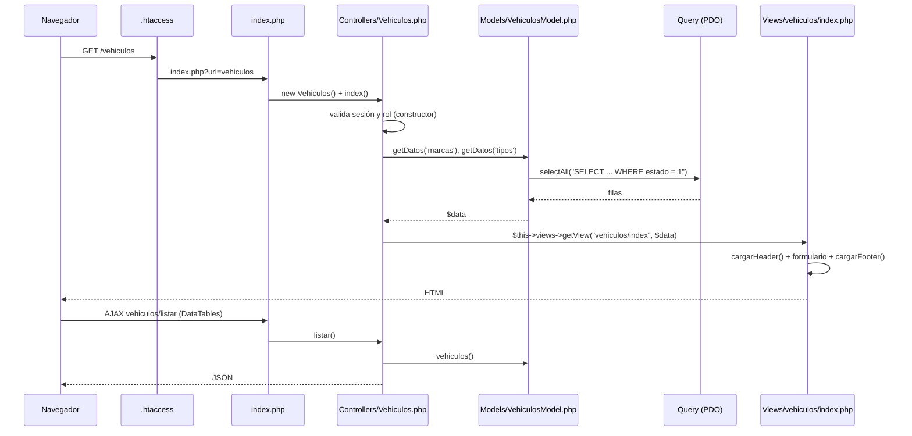

# Flujo de ejecución: de `index.php` a la pantalla

Guía para explicar, con el código abierto, cómo una URL termina mostrando una pantalla.
Ejemplo usado en toda la guía: el módulo **Vehículos** (`/coop_rio_amazonas/vehiculos`).

---

## Resumen en una línea

```
URL → .htaccess → index.php → Controllers/Vehiculos.php → Models/VehiculosModel.php → Query (PDO) → MariaDB
                                       │
                                       └→ Views::getView() → Views/vehiculos/index.php → cargarHeader() / cargarFooter()
```



---

## Paso a paso (con archivo y línea)

### Paso 0: `.htaccess` (reescritura de URL)
Apache recibe `/coop_rio_amazonas/vehiculos` y, como no es un archivo ni carpeta real, la convierte en
`index.php?url=vehiculos`. Por eso **todas** las peticiones pasan por `index.php`.

### Paso 1: `index.php` (punto de entrada único)
| Línea | Qué hace |
|---|---|
| 19 | Carga `Config/Config.php` (base_url, conexión a la BD, SMTP). |
| 23 | Lee `$_GET['url']`. Si no hay URL usa `major/index` (página pública de inicio). |
| 26–28 | Divide la URL: `vehiculos/editar/5` → controlador `Vehiculos`, método `editar`, parámetro `5`. Si no hay método se usa `index`. |
| 31–32 | Carga el autoload (clases de `Config/App/`) y las funciones de ayuda (`Config/Helpers.php`). |
| 41–42 | Incluye `Controllers/Vehiculos.php` y crea el objeto (`new Vehiculos()`). |
| 44–45 | Si el método es público, lo ejecuta: `$objeto->index("")`. |
| 47, 51 | Si el controlador o el método no existen → redirige a `errors`. |

### Paso 2: el constructor del controlador
**`Controllers/Vehiculos.php`, líneas 8–17**
1. `session_start()` abre la sesión.
2. Si no hay sesión o no es personal (`tipo != 1`) → redirige a `login` y **`exit`** detiene todo.
3. `parent::__construct()` ejecuta la clase base **`Config/App/Controller.php`** (líneas 12–17):
   - `new Views()` → objeto que sabe cargar vistas.
   - `cargarModel()` (línea 18) → por convención de nombres carga `Models/VehiculosModel.php` y lo guarda en `$this->model`.
   - `cargarNotificaciones()` (línea 29) → si es personal, pide al modelo de reservas las pendientes para la campana del menú.

### Paso 3: el método del controlador llama al modelo
**`Controllers/Vehiculos.php`, líneas 19–24 (`index`)**
```php
$data['marcas'] = $this->model->getDatos('marcas');
$data['tipos']  = $this->model->getDatos('tipos');
$this->views->getView("vehiculos/index", $data);
```
El controlador **no** tiene SQL ni reglas: solo pide datos y elige la vista.

### Paso 4: el modelo consulta la base de datos
**`Models/VehiculosModel.php`, línea 135 (`getDatos`)** → arma el SQL y llama a `selectAll()`.
**`Config/App/Query.php`, líneas 17–23** → `prepare()` + `execute()` con PDO (consultas preparadas).
**`Config/App/Conexion.php`, línea 8** → la conexión `new PDO(...)` se crea una vez al instanciar el modelo.

### Paso 5: la vista
**`Config/App/Views.php`, líneas 13–17** → `getView()` hace `require "Views/vehiculos/index.php"`.
Dentro de la vista quedan disponibles `$data` (del modelo) y `$notificaciones` (para la campana).

### Paso 6: header y footer
**`Views/vehiculos/index.php`**
| Línea | Qué hace |
|---|---|
| 1 | `cargarHeader($_SESSION['tipo'])` → abre el HTML, menú y campana. |
| 69–71, 80–82 | Recorre `$data['marcas']` y `$data['tipos']` para llenar los `<select>`. |
| 166 | `cargarFooter($_SESSION['tipo'])` → scripts comunes y cierre del HTML. |
| 168 | Carga el JS propio del módulo: `Assets/js/pages/vehiculos.js`. |

**`Config/Helpers.php`**
| Línea | Rol | Plantilla |
|---|---|---|
| 39–45 `cargarHeader` | tipo 1 (personal) | `Views/Templates/header.php` |
|  | tipo 2 (cliente) | `Views/Templates/header-cliente.php` |
| 47–53 `cargarFooter` | tipo 1 / tipo 2 | `footer.php` / `footer-cliente.php` |

Las páginas **públicas** (`Views/index.php`, `about.php`, `cars.php`, `pricing.php`, `contact.php`, `services.php`)
no usan esas funciones: incluyen directamente `Templates/header1.php`, `portada.php` y `footer1.php`.

### Paso 7: peticiones AJAX (tablas y formularios)
Una vez cargada la página, el JavaScript hace nuevas peticiones que recorren **el mismo camino** (pasos 0 a 4),
pero el controlador responde **JSON** en lugar de una vista:

| Acción en pantalla | JS | URL | Controlador | Modelo |
|---|---|---|---|---|
| Llenar la tabla | `vehiculos.js` línea 9 | `vehiculos/listar` | `listar()` línea 26 | `vehiculos()` línea 152 |
| Guardar el formulario | `vehiculos.js` línea 61 | `vehiculos/registrar` | `registrar()` línea 41 | `guardar()` línea 25 |
| Editar | `btnEditarVeh(id)` | `vehiculos/editar/5` | `editar(5)` | `getVehiculo(5)` |
| Dar de baja | `btnEliminarVeh(id)` | `vehiculos/eliminar/5` | `eliminar(5)` | `darDeBaja(5)` |

---

## Responsabilidad de cada capa (lo que pidió el tutor)

| Capa | Archivos | Hace | No hace |
|---|---|---|---|
| Entrada | `index.php`, `.htaccess` | Decide qué controlador y método ejecutar | Lógica de negocio |
| Controlador | `Controllers/*.php` | Recibe datos (`$_POST`, URL), valida sesión/rol, llama al modelo, responde (vista o JSON) | SQL, cálculos, validaciones de negocio |
| Modelo | `Models/*Model.php` | Reglas de negocio (bloque "REGLAS DE NEGOCIO") y SQL con `?` (bloque "ACCESO A DATOS") | Imprimir HTML |
| Vista | `Views/**/*.php`, `Views/Templates/` | Mostrar `$data` en HTML | Consultar la base de datos |

---

## Cómo demostrarlo en vivo

1. Abrir `index.php` y explicar las líneas 23–28 con la URL que está en el navegador.
2. Seguir con Ctrl+clic a `Controllers/Vehiculos.php` → constructor → `index()`.
3. Abrir `Config/App/Controller.php` y mostrar `cargarModel()`: por eso `$this->model` es `VehiculosModel`.
4. Ir a `Models/VehiculosModel.php` → `getDatos()` → `Query::selectAll()`.
5. Volver a `index()` → `getView()` → `Config/App/Views.php` → `Views/vehiculos/index.php`.
6. Mostrar la línea 1 (`cargarHeader`) y saltar a `Config/Helpers.php` → `Templates/header.php`.
7. En el navegador, abrir las herramientas de desarrollo (F12 → Red) y mostrar la petición `vehiculos/listar`
   que devuelve JSON: es el mismo recorrido, sin vista.

**Cambio en vivo sugerido** (si el tutor lo pide): en `Models/VehiculosModel.php`, dentro de `guardar()`,
cambiar el mensaje `'Los precios deben ser números mayores a 0'`, guardar un vehículo con precio 0 y mostrar el nuevo mensaje.
